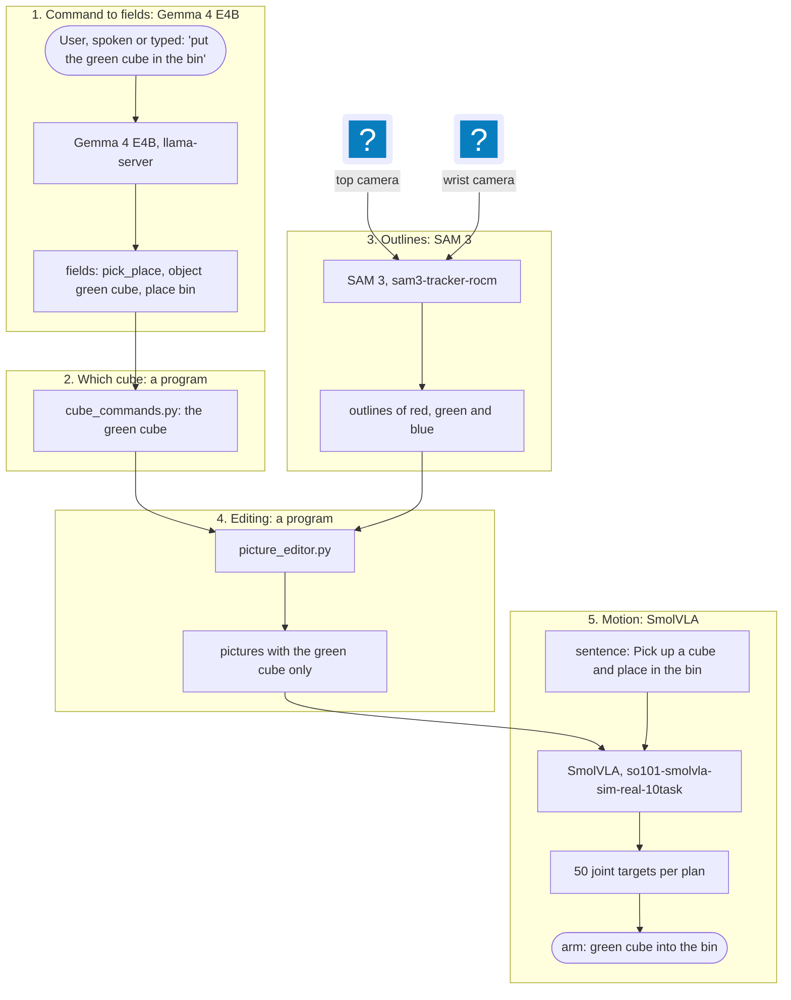

# SO-101 SmolVLA digital twins

Two separate simulated SO-101 environments evaluate a SmolVLA checkpoint
fine-tuned in the upstream SAPIEN training environment.

## Models evaluated

What works and what does not, model by model, is in `RESEARCH.md`, section
["Models evaluated in this workshop: what works and what does not"](RESEARCH.md#r-models-evaluated-what-works-and-what-does-not),
with the literature it follows from. In short: the checkpoint puts one cube
into the bin (10 of 10 in the SAPIEN twin), stacks its one trained pair
unreliably (24 of 60), and cannot choose between objects by the sentence.

## Use case: pick the cube the user names and place it in the bin

Three cubes, red, green and blue, lie on the table beside a bin. The user says
or types which cube goes next, in their own words: "grab the green one and
drop it in the box". The arm picks that cube, places it in the bin and waits
for the next command.

**Why SAM 3 is needed.** The VLA (SmolVLA, the checkpoint as published) is
confused by a picture with several objects to choose from: the sentence does
not steer it, and a second cube pulls the gripper towards itself. It works
when it sees a single object. Measured here with two and with three cubes
(`RESEARCH.md`, ["Models evaluated in this workshop"](RESEARCH.md#r-models-evaluated-what-works-and-what-does-not);
`DEVELOPMENT_LEDGER.md`, ["Several objects in one scene"](DEVELOPMENT_LEDGER.md#d-2026-11-20-several-objects-in-one-scene))
and the same in the published work on this class of model
(`RESEARCH.md`, [Finding 1](RESEARCH.md#r-finding-1)). The way out that the
literature supports is to decide outside the VLA which object is meant and to
paint every other object over with background before the pictures reach it
([Main conclusion](RESEARCH.md#r-main-conclusion), [Finding 6](RESEARCH.md#r-finding-6),
[Finding 8](RESEARCH.md#r-finding-8)). SAM 3 provides the outlines that make
that painting possible: it finds every cube in both camera pictures, and the
colour inside each outline says which cube it is. Nothing in the checkpoint
was changed and nothing was fine-tuned. Built and measured in the SAPIEN twin
on 2026-11-22; the design is `SPEC.md`, sections 3, 4.7 and 6.



| Stage | Input | What happens | Model or program |
|---|---|---|---|
| 1. Understand the command | The sentence, spoken (one 6 s clip) or typed | Gemma 4 answers under a grammar with the command and its fields: `pick_place`, the object words, the place words, and what it heard. | Gemma 4 E4B, run by `llama-server` through the voice client in `voice/` |
| 2. Choose the cube | Gemma's fields | The one colour in the object field selects the cube. "The cube", "red ball", two colours, a question or another command are refused and nothing moves. The place is recorded but not used, because a pick always ends in the bin. | `src/so101_smolvla/cube_commands.py` |
| 3. Outline the cubes | Both camera pictures, each time SmolVLA plans (every 50 steps) | SAM 3 outlines everything that matches the phrase "cube"; the colour inside an outline tells which cube it is. | SAM 3, `sam3-tracker-rocm` compiled with MIGraphX, in `.venv-sam3` |
| 4. Hide the other cubes | The chosen cube and SAM 3's outlines | The two cubes the command does not name are painted over with the empty table and bin, in the top and the wrist picture. | `src/so101_smolvla/picture_editor.py` |
| 5. Move the arm | The edited pictures and the trained sentence | SmolVLA predicts 50 joint targets per plan, 400 steps per command. The simulator's rule decides when the cube counts as placed. | SmolVLA `Harrysunshine/so101-smolvla-sim-real-10task`, SAPIEN twin |

### Automated testing

Video of the first layout of the run commanded by typed sentences
(`vla_testing/random-three-cubes-sapien-others-painted-sam3-gemma-typed-20261122-184944`,
seed 0: "pick up the blue cube and put it in the box", "put the red cube in
the bin", "grab the green one and drop it in the box", all three placed):
[media/three-cubes-gemma-typed/seed-00000-feeds.mp4](media/three-cubes-gemma-typed/seed-00000-feeds.mp4).
Each row is one camera, top and wrist, with three pictures: the scene as the
camera takes it at every step; the outlines SAM 3 gave when SmolVLA last
planned, tinted by what was done with each (target, painted over, not used);
and the picture SmolVLA was given. The caption carries Gemma's call for the
current command.

Measured on ten random layouts (three commands each, `TESTING_LEDGER.md`,
[the fast SAM 3 run](TESTING_LEDGER.md#t-2026-11-22-fast-sam3-run) and
[the run commanded by sentences](TESTING_LEDGER.md#t-2026-11-22-gemma-commands)):

| Pictures given to SmolVLA | Layouts with all three cubes in the bin | Commands whose cube was in the bin |
|---|---:|---:|
| as the cameras take them (no SAM 3, no editing) | 0 of 10 | 1 of 30 |
| the other two cubes painted over by SAM 3's outlines, cubes given as colours | 9 of 10 | 29 of 30 |
| the same, each cube named by a typed sentence through Gemma 4 | 9 of 10 | 29 of 30 |

Typed, all 30 phrasings (ten per colour: pick up, put, grab, place, move,
take; box, bin, container or no place; with fillers) gave their cube, and all
7 sentences that should move nothing were refused. In a synthetic voice 29 of
30 and 5 of 7: a question ("is the red cube in the box") and a negation ("do
not pick up the red cube") became a pick of the red cube. That is a known
weak point of the spoken form (`SPEC.md`, section 10), held by a test that
stays red until it is fixed.

To run it (the SAPIEN twin, the SAM 3 environment and the voice workshop
`workshops/vvla-pipeline` set up; the Gemma server is started on port 8083
and stopped by the run):

```bash
./scripts/run_sapien_rollout.sh --task pick-place-three-cubes --pictures others-painted \
  --outlines sam3 --sentences built-in --count 10
# your own sentences: a JSON list of layouts, each a list of sentences
./scripts/run_sapien_rollout.sh --task pick-place-three-cubes --pictures others-painted \
  --outlines sam3 --sentences my_sentences.json --count 1
# the same sentences said by the synthetic voice
./scripts/run_sapien_rollout.sh --task pick-place-three-cubes --pictures others-painted \
  --outlines sam3 --sentences built-in --spoken --count 1
```

The run folder under `vla_testing/` holds, per layout, a `feeds.mp4` with a
row per camera: the picture as taken, SAM 3's outlines with what was done with
each, and the picture SmolVLA was given; its `REPORT.md` lists every sentence,
what Gemma heard, its call and the cube chosen.

## Environment

Run these commands from this directory. The system ROCm (Radeon Open Compute) install is left as it is. This machine's integrated GPU is gfx1151. TorchCodec, LeRobot's video decoder, needs the system `ffmpeg` package.

The pins come from the [ROCm 10.1.0 pip install](https://rocm.docs.amd.com/en/docs-10.1.0/install/rocm.html) and the [PyTorch for ROCm 10.1.0](https://rocm.docs.amd.com/projects/ai-ecosystem/en/latest/frameworks/pytorch/install.html?rocm-ver=10.1.0) page for gfx1151. The constraint file keeps those wheels when LeRobot is installed.

```bash
uv venv --python 3.12 .venv
uv pip install --python .venv/bin/python --index-url https://stable.repo.amd.com/rocm/whl-next/ \
  "rocm[libraries,device-gfx1151]==10.1.0" \
  "torch[device-gfx1151]==2.14.0+rocm10.1.0" \
  "torchvision[device-gfx1151]==0.29.0a0+rocm10.1.0" \
  "torchaudio==2.11.0.3+rocm10.1.0"

.venv/bin/python - <<'PY' > constraints.txt
import importlib.metadata as m
for pkg in ("torch", "torchvision", "torchaudio", "numpy", "triton"):
    print(f"{pkg}=={m.version(pkg)}")
PY

export UV_OVERRIDE="$PWD/constraints.txt"
export PIP_CONSTRAINT="$PWD/constraints.txt"
uv pip install --python .venv/bin/python "lerobot[smolvla,training]"

.venv/bin/python -m rocm_sdk test
.venv/bin/python -c "import torch, torchvision; assert torch.version.hip; assert '+rocm' in torchvision.__version__; assert torch.cuda.is_available()"
```

## SAPIEN policy backend

MuJoCo and SAPIEN are two separate digital twins:

- The MuJoCo twin uses this repository's MJCF robot, scene, collision model,
  physics, position controller, cameras, and placement check.
- The SAPIEN twin uses the pinned upstream KIT URDF, independently constructed
  scene and collisions, PhysX physics, damped proportional-derivative
  controller, cameras, and native success check.

They share the checkpoint-facing six-value state/action convention and nominal
camera calibration. They do not share geometry, simulator state, controllers,
physics, or task state. MuJoCo remains the default. The complete original
`SO101PickPlaceCube40-v1` SAPIEN environment is available as an alternative
policy-evaluation backend:

```bash
./scripts/setup_sapien_env.sh
make random BACKEND=sapien COUNT=10 STEPS=300
make random BACKEND=mujoco COUNT=10 STEPS=300
```

Random regressions are written to timestamped `random-sapien-*` and
`random-MuJoCo-*` directories.

On this AMD machine the two engines run in separate processes:

- SmolVLA inference runs on the integrated GPU through ROCm.
- SAPIEN/PhysX physics, control, and rendering run on the CPU. SAPIEN GPU
  acceleration requires NVIDIA CUDA and is not used here.

The setup script pins `Xbotics-SO101-Sim` commit
`239b38e076387b11d5c0b0da29487edcbde5f905` in `/tmp/Xbotics-SO101-Sim` and
creates `.venv-sapien`. The SAPIEN worker owns the complete simulation and
returns the state and both 640×480 camera observations to the ROCm policy
process through a versioned binary protocol.

For explicit output and seeds:

```bash
./scripts/run_sapien_rollout.sh \
  --count 1 \
  --steps 300 \
  --environment-seed-base 0 \
  --policy-seed-base 0 \
  --output vla_testing/sapien-seed0
```

Each completed episode contains `result.json`, `trajectory.npz`,
`policy-observations.npz`, top/wrist videos, a combined `rollout.mp4`, and a
`COMPLETE.json` marker written last. The batch directory also contains a report
and accumulated videos.

## Published environment

The published LeRobot scene is four cubes. This project's demo remains the one-cube SO-101 digital twin, simulated in MuJoCo. Set `MUJOCO_GL=osmesa` so rendering stays off the integrated GPU.

```python
import os

os.environ["MUJOCO_GL"] = "osmesa"

from lerobot.envs import HubEnvConfig, make_env

envs = make_env(
    HubEnvConfig(
        hub_path="lerobot/so101-tabletop-mujoco@4684f500b94d07194f2c860314c4e27cb9349e8c",
        trust_remote_code=True,
    ),
    n_envs=1,
)
```
