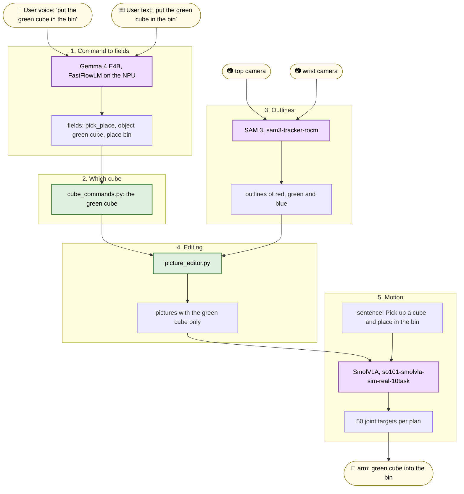
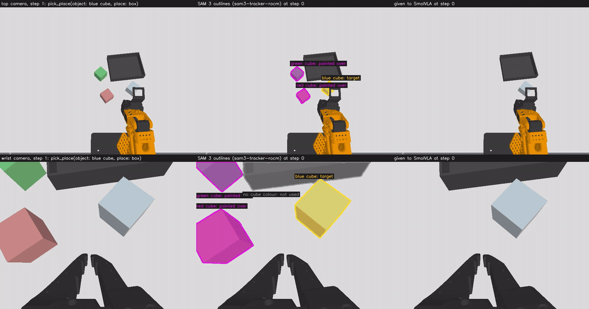

# SO-101 SmolVLA digital twins

Two separate simulated SO-101 environments evaluate a SmolVLA checkpoint
fine-tuned in the upstream SAPIEN training environment.

## Models evaluated

What works and what does not, model by model, is in `RESEARCH.md`, section
["Models evaluated in this workshop: what works and what does not"](RESEARCH.md#r-models-evaluated-what-works-and-what-does-not),
with the literature it follows from. In short: the checkpoint puts one cube
into the bin (10 of 10 in the SAPIEN twin), stacks its one trained pair
unreliably (24 of 60), and cannot choose between objects by the sentence.

## Use case: pick the cube the user names and place it in the bin

Three cubes, red, green and blue, lie on the table beside a bin. The user says
or types which cube goes next, in their own words: "grab the green one and
drop it in the box". The arm picks that cube, places it in the bin and waits
for the next command.

**Why SAM 3 is needed.** The VLA (SmolVLA, the checkpoint as published) is
confused by a picture with several objects to choose from: the sentence does
not steer it, and a second cube pulls the gripper towards itself. It works
when it sees a single object. Measured here with two and with three cubes
(`RESEARCH.md`, ["Models evaluated in this workshop"](RESEARCH.md#r-models-evaluated-what-works-and-what-does-not);
`DEVELOPMENT_LEDGER.md`, ["Several objects in one scene"](DEVELOPMENT_LEDGER.md#d-2026-11-20-several-objects-in-one-scene))
and the same in the published work on this class of model
(`RESEARCH.md`, [Finding 1](RESEARCH.md#r-finding-1)). The way out that the
literature supports is to decide outside the VLA which object is meant and to
paint every other object over with background before the pictures reach it
([Main conclusion](RESEARCH.md#r-main-conclusion), [Finding 6](RESEARCH.md#r-finding-6),
[Finding 8](RESEARCH.md#r-finding-8)). SAM 3 provides the outlines that make
that painting possible: it finds every cube in both camera pictures, and the
colour inside each outline says which cube it is. Nothing in the checkpoint
was changed and nothing was fine-tuned. Built and measured in the SAPIEN twin
on 2026-11-22; the design is `SPEC.md`, sections 3, 4.7 and 6.



Purple boxes are the three AI models, green boxes the two programs, yellow
rounded boxes the inputs and the output; the plain boxes are what passes
between them.

| Stage | Input | What happens | Model or program |
|---|---|---|---|
| 1. Understand the command | The sentence, spoken (one 6 s clip) or typed | Gemma 4 answers in one fixed shape with the command and its fields: `pick_place`, the object words, the place words, and what it heard. The shape is held by a JSON schema in the request. | Gemma 4 E4B, run by FastFlowLM on the NPU (the neural processing unit), through this workshop's voice client, `src/so101_smolvla/voice/`. The integrated graphics is the other choice: [Configuration](#configuration) |
| 2. Choose the cube | Gemma's fields | The one colour in the object field selects the cube. "The cube", "red ball", two colours, a question or another command are refused and nothing moves. The place is recorded but not used, because a pick always ends in the bin. | `src/so101_smolvla/cube_commands.py` |
| 3. Outline the cubes | Both camera pictures, each time SmolVLA plans (every 50 steps) | SAM 3 outlines everything that matches the phrase "cube"; the colour inside an outline tells which cube it is. | SAM 3, `sam3-tracker-rocm` compiled with MIGraphX, in `.venv-sam3` |
| 4. Hide the other cubes | The chosen cube and SAM 3's outlines | The two cubes the command does not name are painted over with the empty table and bin, in the top and the wrist picture. | `src/so101_smolvla/picture_editor.py` |
| 5. Move the arm | The edited pictures and the trained sentence | SmolVLA predicts 50 joint targets per plan, 400 steps per command. The simulator's rule decides when the cube counts as placed. | SmolVLA `Harrysunshine/so101-smolvla-sim-real-10task`, SAPIEN twin |

### Automated testing

The first layout of the run of 2026-11-22, 17:12, with the fast SAM 3
(`vla_testing/random-three-cubes-sapien-others-painted-sam3-fast-20261122-171213`,
seed 0, the cubes commanded as colours in the order blue, red, green, all
three placed). The moving picture is the run's video at 1280 pixels wide and
10 frames per second; on GitHub a click on it pauses and resumes it. The
video itself, 1920 pixels wide at 30 frames per second, is
[media/three-cubes-sam3-fast/seed-00000-feeds.mp4](media/three-cubes-sam3-fast/seed-00000-feeds.mp4);
GitHub shows no player for a video file in a repository, only a download.



Each row is one camera, top and wrist, with three pictures: the scene as the
camera takes it at every step; the outlines SAM 3 gave when SmolVLA last
planned, tinted by what was done with each (target, painted over, not used);
and the picture SmolVLA was given. The caption carries the command. The run
commanded by typed sentences through Gemma ended identically, step for step,
on this layout and the nine others.

Measured on ten random layouts (three commands each, `TESTING_LEDGER.md`,
[the fast SAM 3 run](TESTING_LEDGER.md#t-2026-11-22-fast-sam3-run) and
[the run commanded by sentences](TESTING_LEDGER.md#t-2026-11-22-gemma-commands)):

| Pictures given to SmolVLA | Layouts with all three cubes in the bin | Commands whose cube was in the bin |
|---|---:|---:|
| as the cameras take them (no SAM 3, no editing) | 0 of 10 | 1 of 30 |
| the other two cubes painted over by SAM 3's outlines, cubes given as colours | 9 of 10 | 29 of 30 |
| the same, each cube named by a typed sentence through Gemma 4 | 9 of 10 | 29 of 30 |

Typed, all 30 phrasings (ten per colour: pick up, put, grab, place, move,
take; box, bin, container or no place; with fillers) gave their cube, and all
7 sentences that should move nothing were refused. In a synthetic voice 29 of
30 and 5 of 7: a question ("is the red cube in the box") and a negation ("do
not pick up the red cube") became a pick of the red cube. That is a known
weak point of the spoken form (`SPEC.md`, section 10), held by a test that
stays red until it is fixed.

To run it (the SAPIEN twin and the SAM 3 environment set up; with
`--sentences`, also the voice path, `./scripts/setup_voice.sh` in the
Environment section; the Gemma server is started on port 8083 and stopped by
the run):

```bash
# the cubes commanded as colours, no Gemma: the run of the video above
./scripts/run_sapien_rollout.sh --task pick-place-three-cubes --pictures others-painted \
  --outlines sam3 --count 10
# the cubes named by the test's own sentences through Gemma 4
./scripts/run_sapien_rollout.sh --task pick-place-three-cubes --pictures others-painted \
  --outlines sam3 --sentences built-in --count 10
# your own sentences: a JSON list of layouts, each a list of sentences
./scripts/run_sapien_rollout.sh --task pick-place-three-cubes --pictures others-painted \
  --outlines sam3 --sentences my_sentences.json --count 1
# the same sentences said by the synthetic voice
./scripts/run_sapien_rollout.sh --task pick-place-three-cubes --pictures others-painted \
  --outlines sam3 --sentences built-in --spoken --count 1
```

The run folder under `vla_testing/` holds, per layout, a `feeds.mp4` with a
row per camera: the picture as taken, SAM 3's outlines with what was done with
each, and the picture SmolVLA was given; its `REPORT.md` lists every sentence,
what Gemma heard, its call and the cube chosen.

### Live demo

`notebooks/pick_place_demo.ipynb` runs the same use case with a person at the
microphone: say which cube goes next and watch the six pictures of the feeds
video live, with a voice meter, the transcript of what Gemma heard and called,
the command's progress and the gripper's jaw opening, beside the utilization
and power window. The pick-and-place loop is the one the test runs
(`src/so101_smolvla/pick_place.py`); the notebook, the batch runner and the
tests share it. `notebooks/run_notebooks.sh` registers the kernel and opens
JupyterLab; `tests/test_demo_notebook.py` runs the notebook against the real
Gemma, SAM 3 and SAPIEN.

## Compute placement

A run is four processes: the main one (`.venv`: the runner, the Gemma client,
the picture editing and SmolVLA), the Gemma server (FastFlowLM's `flm serve`),
the SAM 3 worker (`.venv-sam3`) and the SAPIEN worker (`.venv-sapien`). Gemma
runs on the NPU (the neural processing unit); SAM 3 and SmolVLA share the
integrated graphics processor (iGPU). The simulator, the picture editing and
the video encoding are on the processor cores. The machine (AMD Ryzen AI Max+
PRO 395) has 16 cores with two threads each, so 32 logical processors, in two
L3 cache complexes: processors 0 to 15 and 16 to 31, and an XDNA 2 NPU. The
utilization table shows the NPU held at 97 to 99 % and about 2.2 W for as long
as the server holds the model, between requests as well as during one; it does
not show the requests themselves.

This is the placement of the settings as they are in git: `backend = "npu"` in
`configs/models.toml`. Gemma can run on the integrated graphics instead, beside
SAM 3 and SmolVLA; that is one line of that file ([Configuration](#configuration)).

The launchers pin nothing yet: every process may use all 32 processors.
Measured on one full layout (`TESTING_LEDGER.md`,
[the measurement](TESTING_LEDGER.md#t-2026-11-22-core-placement)): with the
default thread pools the run keeps about 16 processors busy, twelve of them
torch's worker threads spinning in the main process while the policy runs on
the graphics processor. Pinned to five physical cores (processors 0 to 9) with
the pools capped to four threads (`OMP_NUM_THREADS=4`), the same layout
finished 12 s sooner, with the same result step for step, on 1.7 processors'
worth of work. The column "Dedicated CPUs" is that measured placement.

<table style="border-collapse: collapse">
<thead>
<tr><th style="background-color: rgba(128, 128, 128, 0.2); border: 1px solid rgba(128, 128, 128, 0.4)">Task</th><th style="border: 1px solid rgba(128, 128, 128, 0.4)">Model or algorithm</th><th style="border: 1px solid rgba(128, 128, 128, 0.4)">What it does</th><th style="border: 1px solid rgba(128, 128, 128, 0.4)">Runs on</th><th style="border: 1px solid rgba(128, 128, 128, 0.4)">Runtime and process</th><th style="border: 1px solid rgba(128, 128, 128, 0.4)">Dedicated CPUs (measured, to be applied)</th></tr>
</thead>
<tbody>
<tr><td rowspan="3" valign="middle" style="background-color: rgba(128, 128, 128, 0.2); vertical-align: middle; border: 1px solid rgba(128, 128, 128, 0.4)">Voice command</td><td style="border: 1px solid rgba(128, 128, 128, 0.4)">Microphone and VAD: 20 ms frames, Silero speech detection (ONNX Runtime on the CPU) gates each frame; every 2 s with speech the last 6 s go to Gemma (the demo and the voice notebook)</td><td style="border: 1px solid rgba(128, 128, 128, 0.4)">hears the room, decides which sound is speech</td><td style="border: 1px solid rgba(128, 128, 128, 0.4)">CPU</td><td style="border: 1px solid rgba(128, 128, 128, 0.4)">Python, the microphone thread of the main process (<code>so101_smolvla.voice.microphone</code>)</td><td style="border: 1px solid rgba(128, 128, 128, 0.4)">0 to 9, with the run; a fraction of one processor</td></tr>
<tr><td style="border: 1px solid rgba(128, 128, 128, 0.4)">Gemma 4 E4B with its audio encoder</td><td style="border: 1px solid rgba(128, 128, 128, 0.4)">understands user intent and produces robot commands</td><td style="border: 1px solid rgba(128, 128, 128, 0.4)">NPU</td><td style="border: 1px solid rgba(128, 128, 128, 0.4)">FastFlowLM <code>flm serve gemma4e-flash:e4b</code> (Q4_1, XDNA 2 through the <code>amdxdna</code> driver and XRT), a child of the main process, on the runner's port of <code>configs/voice.toml</code>. The answer is read as it is written, and the call (command, object, place) comes first in it: the pick starts when the call is complete, the words Gemma heard follow. Seconds over 37 sentences, median (<a href="TESTING_LEDGER.md#t-2026-11-23-call-first">the ledger</a>): to the call 1.94 typed, 2.61 spoken; to the end of the answer 3.10 and 3.75. The NPU decodes at 13 to 14 tokens per second; the answer is 25 to 39 tokens</td><td style="border: 1px solid rgba(128, 128, 128, 0.4)">0 to 9, with the run; at most two threads busy</td></tr>
<tr><td style="border: 1px solid rgba(128, 128, 128, 0.4)">espeak-ng (the test's synthetic voice) and the Gemma client</td><td style="border: 1px solid rgba(128, 128, 128, 0.4)">speaks a test sentence, sends text or speech to Gemma</td><td style="border: 1px solid rgba(128, 128, 128, 0.4)">CPU</td><td style="border: 1px solid rgba(128, 128, 128, 0.4)">Python, the main process (<code>so101_smolvla.voice</code>, <code>.venv</code>)</td><td style="border: 1px solid rgba(128, 128, 128, 0.4)">0 to 9, with the run</td></tr>
<tr><td valign="middle" style="background-color: rgba(128, 128, 128, 0.2); vertical-align: middle; border: 1px solid rgba(128, 128, 128, 0.4)">Choosing the cube</td><td style="border: 1px solid rgba(128, 128, 128, 0.4)">a program, <code>cube_commands.py</code></td><td style="border: 1px solid rgba(128, 128, 128, 0.4)">picks the cube the command names; refuses a command that names no single cube</td><td style="border: 1px solid rgba(128, 128, 128, 0.4)">CPU</td><td style="border: 1px solid rgba(128, 128, 128, 0.4)">Python, the main process</td><td style="border: 1px solid rgba(128, 128, 128, 0.4)">0 to 9, with the run</td></tr>
<tr><td valign="middle" style="background-color: rgba(128, 128, 128, 0.2); vertical-align: middle; border: 1px solid rgba(128, 128, 128, 0.4)">Outlines</td><td style="border: 1px solid rgba(128, 128, 128, 0.4)">SAM 3 (<code>sam3-tracker-rocm</code>, 504 px, compiled with MIGraphX; mask decoder and memory encoder in PyTorch)</td><td style="border: 1px solid rgba(128, 128, 128, 0.4)">finds every cube in both camera pictures</td><td style="border: 1px solid rgba(128, 128, 128, 0.4)">iGPU</td><td style="border: 1px solid rgba(128, 128, 128, 0.4)">ONNX Runtime MIGraphX EP and torch (ROCm), the SAM 3 worker (<code>.venv-sam3</code>)</td><td style="border: 1px solid rgba(128, 128, 128, 0.4)">0 to 9; a quarter of one processor</td></tr>
<tr><td valign="middle" style="background-color: rgba(128, 128, 128, 0.2); vertical-align: middle; border: 1px solid rgba(128, 128, 128, 0.4)">Picture editing</td><td style="border: 1px solid rgba(128, 128, 128, 0.4)">a program, <code>picture_editor.py</code></td><td style="border: 1px solid rgba(128, 128, 128, 0.4)">hides the cubes that were not named, in both camera pictures</td><td style="border: 1px solid rgba(128, 128, 128, 0.4)">CPU</td><td style="border: 1px solid rgba(128, 128, 128, 0.4)">NumPy, the main process</td><td style="border: 1px solid rgba(128, 128, 128, 0.4)">0 to 9, with the run</td></tr>
<tr><td valign="middle" style="background-color: rgba(128, 128, 128, 0.2); vertical-align: middle; border: 1px solid rgba(128, 128, 128, 0.4)">Motion</td><td style="border: 1px solid rgba(128, 128, 128, 0.4)">SmolVLA, <code>Harrysunshine/so101-smolvla-sim-real-10task</code></td><td style="border: 1px solid rgba(128, 128, 128, 0.4)">moves the arm: 50 joint targets per plan from the edited pictures</td><td style="border: 1px solid rgba(128, 128, 128, 0.4)">iGPU</td><td style="border: 1px solid rgba(128, 128, 128, 0.4)">torch (ROCm) through LeRobot, the main process (<code>.venv</code>)</td><td style="border: 1px solid rgba(128, 128, 128, 0.4)">0 to 9, torch capped to 4 threads: 0.6 of a processor instead of 12 spinning</td></tr>
<tr><td rowspan="2" valign="middle" style="background-color: rgba(128, 128, 128, 0.2); vertical-align: middle; border: 1px solid rgba(128, 128, 128, 0.4)">Digital twin</td><td style="border: 1px solid rgba(128, 128, 128, 0.4)">SAPIEN with PhysX</td><td style="border: 1px solid rgba(128, 128, 128, 0.4)">simulates the arm, the cubes and the bin; renders both cameras; judges a placed cube</td><td style="border: 1px solid rgba(128, 128, 128, 0.4)">CPU (SAPIEN's GPU path needs CUDA)</td><td style="border: 1px solid rgba(128, 128, 128, 0.4)">the SAPIEN worker (<code>.venv-sapien</code>), framed pipe protocol</td><td style="border: 1px solid rgba(128, 128, 128, 0.4)">0 to 9, capped to 4 threads: 0.3 of a processor instead of 3.6</td></tr>
<tr><td style="border: 1px solid rgba(128, 128, 128, 0.4)">MuJoCo (the default one-cube twin)</td><td style="border: 1px solid rgba(128, 128, 128, 0.4)">simulates the arm and the table scene</td><td style="border: 1px solid rgba(128, 128, 128, 0.4)">CPU (rendering with OSMesa)</td><td style="border: 1px solid rgba(128, 128, 128, 0.4)">MuJoCo, the main process</td><td style="border: 1px solid rgba(128, 128, 128, 0.4)">0 to 9 when it is the twin of a run</td></tr>
<tr><td valign="middle" style="background-color: rgba(128, 128, 128, 0.2); vertical-align: middle; border: 1px solid rgba(128, 128, 128, 0.4)">Videos</td><td style="border: 1px solid rgba(128, 128, 128, 0.4)">x264, preset ultrafast</td><td style="border: 1px solid rgba(128, 128, 128, 0.4)">writes the video clips of a layout and of the whole run</td><td style="border: 1px solid rgba(128, 128, 128, 0.4)">CPU</td><td style="border: 1px solid rgba(128, 128, 128, 0.4)"><code>ffmpeg</code>, a child of the main process, at the end of a layout</td><td style="border: 1px solid rgba(128, 128, 128, 0.4)">0 to 9; about four processors for a few seconds, while the twin is idle</td></tr>
<tr><td valign="middle" style="background-color: rgba(128, 128, 128, 0.2); vertical-align: middle; border: 1px solid rgba(128, 128, 128, 0.4)">Utilization table</td><td style="border: 1px solid rgba(128, 128, 128, 0.4)">the sampler and a Qt Quick scene</td><td style="border: 1px solid rgba(128, 128, 128, 0.4)">shows utilization and power of CPU, iGPU and NPU, twice a second</td><td style="border: 1px solid rgba(128, 128, 128, 0.4)">CPU (drawn by the iGPU, 0.02 % of it)</td><td style="border: 1px solid rgba(128, 128, 128, 0.4)">PySide6, its own process (<code>utilization_window.py</code>)</td><td style="border: 1px solid rgba(128, 128, 128, 0.4)">10 to 31, outside the run, with the desktop</td></tr>
</tbody>
</table>

Why five cores are enough: the run's useful work is 1.7 processors' worth,
plus four for a few seconds of video encoding per layout. The rest of what
the default configuration consumes is worker threads spinning: torch opens 32
OpenMP threads in the main process and PhysX 16 in the SAPIEN worker, and the
spinning threads of each process fight over the processors. Pinned to five
cores without the cap, the layout took 202 s instead of 142 s; with the cap,
130 s. The other eleven cores, the whole second L3 complex among them, stay
free for the desktop, your own Gemma server and anything else. One layout
cannot claim the 12 s gain, which is within the spread between layouts; the
drop in processor load is certain. To apply it: `taskset -c 0-9` and
`OMP_NUM_THREADS=4` in `scripts/run_sapien_rollout.sh`, then a ten-layout run.

## Configuration

Which model does what, and on which processor, is set in one file:
`configs/models.toml`. It is TOML (the format of `pyproject.toml`), with the
reason for each value as a comment beside it. Nothing else decides it: there
is no command-line switch and no environment variable for it in the demo, the
runner or the notebooks.

```toml
[command]                # Gemma 4 E4B: the sentence, spoken or typed, to fields
backend = "npu"          # "npu" or "igpu": which of the two sections below is used

[command.npu]            # FastFlowLM (flm serve) on the NPU
model = "gemma4e-flash:e4b"

[command.igpu]           # llama-server (llama.cpp) on the integrated graphics
repo = "ggml-org/gemma-4-E4B-it-GGUF"
model = "gemma-4-E4B-it-Q4_0.gguf"

[outlines]               # SAM 3: the cubes in both camera pictures
device = "igpu"
checkout = "~/GitHub/sam3-tracker-rocm-v0.4.0-rc1"

[motion]                 # SmolVLA: the arm
device = "igpu"
checkpoint = "Harrysunshine/so101-smolvla-sim-real-10task"
```

| Section of `configs/models.toml` | What it sets |
|---|---|
| `[command]` `backend` | where Gemma 4 E4B runs: `npu` (as in git) or `igpu` |
| `[command.npu]` | FastFlowLM: the model tag, the program, the lowest version that works, the power mode, how long a start may take |
| `[command.igpu]` | `llama-server`: the Hugging Face repository and the two model files, the context length, the request slots, how long a start may take |
| `[command.igpu.build]` | the llama.cpp build of `scripts/setup_voice.sh`: repository, commit, the graphics target and the override the server runs under |
| `[outlines]` | SAM 3: the checkout of `sam3-tracker-rocm`, its commit, the model directory, the compiled model files; `device` |
| `[motion]` | SmolVLA: the checkpoint; `device` |

Gemma is the one model with a choice of processor. To move it to the
integrated graphics: set `backend = "igpu"`, then run
`./scripts/setup_voice.sh` once (it builds `llama-server` and downloads the two
model files if they are not there). The two sections use the same names for
the same things (`model`, `context`, `ready_timeout_s`). Measured side by side
over the same 37 sentences
([the ledger](TESTING_LEDGER.md#t-2026-11-23-gemma-npu)): the NPU answers a
typed sentence in 3.13 s (median) and a spoken one in 3.76 s; the integrated
graphics in 0.93 s and 1.07 s, while sharing it with SAM 3 and SmolVLA.

`device` of `[outlines]` and `[motion]` states where SAM 3 and SmolVLA run,
the integrated graphics. It is not a switch: neither runs on the NPU today,
and another value is refused when the file is read.

Who reads the file: `src/so101_smolvla/models.py` (`load_models`, the only
reader in Python: the voice settings, the checkpoint loader, the tests and
through them the demo, the batch runner and the notebooks),
`scripts/setup_voice.sh` and `scripts/sam3_reference_settings.sh` (one
`setting` function each). `./scripts/setup_voice.sh --check` says whether
everything the chosen backend needs is on the machine; `--backend igpu|npu`
sets up or checks the other one without changing the file.

The other settings of the workshop:

| File | What it holds | Read by |
|---|---|---|
| `configs/voice.toml` | the voice path around the model: the Gemma server's address and ports (`[server]`), one request's temperature, answer length and time limit (`[request]`), the microphone session (`[listening]`), the test's espeak-ng voice (`[synthetic_voice]`) | `src/so101_smolvla/voice/settings.py` (`load_settings`) |
| `configs/sim.toml` | the MuJoCo twin: the two cameras, the task sentence, cube places | `vla_test.py`, `record.py`, `export_episodes.py` |
| `configs/contract.yaml` | a record, not a setting: what `scripts/write_contract.py` measured of the SmolVLA base checkpoint | written by that script |
| `configs/sapien_stack_recording_rig.json`, `configs/sapien_stack_initial_states.json` | measured data of the stacking scene: the recording rig's cameras and joint zero points, the start states of the recordings. The rig file names the picture of the real table the stacking twin shows behind the arm, `assets/sapien_stack_recording_table.png` | `stack_recording_rig.py`, `stack_initial_states.py` |
| `src/so101_smolvla/sapien_config.py` | the SAPIEN twin: the pinned commit, the tasks, picture sizes | the SAPIEN worker and client |

## Environment

Run these commands from this directory. The system ROCm (Radeon Open Compute) install is left as it is. This machine's integrated GPU is gfx1151. TorchCodec, LeRobot's video decoder, needs the system `ffmpeg` package.

The pins come from the [ROCm 10.1.0 pip install](https://rocm.docs.amd.com/en/docs-10.1.0/install/rocm.html) and the [PyTorch for ROCm 10.1.0](https://rocm.docs.amd.com/projects/ai-ecosystem/en/latest/frameworks/pytorch/install.html?rocm-ver=10.1.0) page for gfx1151. The constraint file keeps those wheels when LeRobot is installed.

```bash
uv venv --python 3.12 .venv
uv pip install --python .venv/bin/python --index-url https://stable.repo.amd.com/rocm/whl-next/ \
  "rocm[libraries,device-gfx1151]==10.1.0" \
  "torch[device-gfx1151]==2.14.0+rocm10.1.0" \
  "torchvision[device-gfx1151]==0.29.0a0+rocm10.1.0" \
  "torchaudio==2.11.0.3+rocm10.1.0"

.venv/bin/python - <<'PY' > constraints.txt
import importlib.metadata as m
for pkg in ("torch", "torchvision", "torchaudio", "numpy", "triton"):
    print(f"{pkg}=={m.version(pkg)}")
PY

export UV_OVERRIDE="$PWD/constraints.txt"
export PIP_CONSTRAINT="$PWD/constraints.txt"
uv pip install --python .venv/bin/python "lerobot[smolvla,training]"

.venv/bin/python -m rocm_sdk test
.venv/bin/python -c "import torch, torchvision; assert torch.version.hip; assert '+rocm' in torchvision.__version__; assert torch.cuda.is_available()"

# The utilization and power table (section below) draws with Qt 6.
uv pip install --python .venv/bin/python "PySide6-Essentials==6.12.0"

# The Gemma 4 voice path (src/so101_smolvla/voice; the model and where it runs in
# configs/models.toml, the rest of its settings in configs/voice.toml): the
# packages into .venv (requests, scipy, sounddevice, onnxruntime, silero-vad with its model,
# huggingface_hub; ipykernel, jupyterlab and nbconvert for the notebooks), then the backend
# of the settings. npu (the default): FastFlowLM 1.0.10 or later must be installed first
# (the Ubuntu 24.04 .deb of https://github.com/ROCm/FastFlowLM/releases) with the NPU driver
# (workshops/ryzen-ai-always-on/README.md, the XRT section); the script pulls the Gemma 4
# model into FastFlowLM's store (~/.config/flm/models). igpu: llama.cpp built with HIP under
# third_party/, the two Gemma files into the Hugging Face cache (~/.cache/huggingface).
# No model is stored in the workshop. Runs again without redoing what is done; --check only
# says what is missing; --backend igpu|npu sets up the other backend.
./scripts/setup_voice.sh
```

The voice notebook, `notebooks/voice_control_test.ipynb`, runs in this same
environment; `notebooks/run_notebooks.sh` registers its kernel and starts
JupyterLab there.

## Utilization and power table

A small always-on-top table, three rows and two columns, read twice a second
from the kernel's own files on the machine it runs on:

| Row | Utilization | Power |
|---|---|---|
| CPU | `/proc/stat`, the difference of two readings; busy is all time minus idle minus iowait (psutil's definition; `top` counts iowait as busy) | the firmware's `average_all_core_power`: the cores only, not the caches, memory controller or fabric |
| iGPU | the graphics driver's `gpu_busy_percent`: the share of the interval in which the graphics engine was not idle (graphics and compute; the video engine is not in it) | the firmware's `average_gfx_power` |
| NPU | the firmware's eight per-column busy values, one segment each; the number is their mean | the firmware's `average_ipu_power` ("IPU" is the firmware's name for the NPU) |

The firmware values come from the platform firmware's metrics table, which the
`amdgpu` driver hands out as `/sys/class/drm/card<N>/device/gpu_metrics`
(format 3.0, `struct gpu_metrics_v3_0`). Three things to know when reading it:

- The three power rows do not add up to the whole chip: about 20 to 30 W go
  to the rest of the chip (memory controller, fabric, display, caches).
- Every value is filtered by the firmware over about one second, so the table
  lags a load by that much. "100 % busy" means the engine was never idle in
  the interval, not that it was saturated.
- The table cannot tell which program loads the graphics. With SAM 3 and
  SmolVLA on the graphics together (and Gemma too, on the `igpu` backend),
  each one's share has to come from timing its stage.
- The NPU row reads 97 to 99 % busy and about 2.2 W whenever FastFlowLM holds
  the Gemma model (the `npu` backend), whether a request runs or not: the
  firmware's busy values follow the held NPU context, not the work. A request
  shows as the seconds the transcript prints, not in this table.

```bash
./scripts/run_utilization_meters.sh                       # the table on this screen
PYTHONPATH=src .venv/bin/python -m so101_smolvla.utilization --once --json   # one reading, no window
PYTHONPATH=src python3 -m so101_smolvla.utilization_meters close             # end a running table
```

From a notebook or another Python program (standard library only, so any
Python on the machine; the notebook `notebooks/voice_control_test.ipynb`,
section 9, has the two cells):

```python
from so101_smolvla.utilization_meters import open_meters, close_meters
open_meters()    # starts the window program if none runs; returns its facts
close_meters()   # ends it, from any process
```

When the robot stack runs on a remote machine, start the table there through
an SSH connection with X11 forwarding; it draws on your screen, which needs an
X server (a Linux desktop has one; on GNOME with Wayland it is XWayland):

```bash
ssh -o ForwardX11=yes -o ForwardX11Trusted=yes <machine> <checkout>/workshops/so101-smolvla/scripts/run_utilization_meters.sh
```

Trusted X11 forwarding gives programs on the remote machine full access to
your display; that is a property of the SSH connection, not of the table.
The window is used with the mouse only: the × closes it, a drag moves it. It
has no entry in the task bar, and on a monitor with fractional scaling under
GNOME 46 it is enlarged by the desktop and looks softer. Measured on this
machine (`TESTING_LEDGER.md`, [the section on the meters](TESTING_LEDGER.md#t-2026-11-22-utilization-meters)):
the window's own graphics time is 0.02 % of the interval with the
graphics-processor renderer, which it uses on a local display; on a forwarded
display it uses Qt Quick's software renderer.

## SAPIEN policy backend

MuJoCo and SAPIEN are two separate digital twins:

- The MuJoCo twin uses this repository's MJCF robot, scene, collision model,
  physics, position controller, cameras, and placement check.
- The SAPIEN twin uses the pinned upstream KIT URDF, independently constructed
  scene and collisions, PhysX physics, damped proportional-derivative
  controller, cameras, and native success check.

They share the checkpoint-facing six-value state/action convention and nominal
camera calibration. They do not share geometry, simulator state, controllers,
physics, or task state. MuJoCo remains the default. The complete original
`SO101PickPlaceCube40-v1` SAPIEN environment is available as an alternative
policy-evaluation backend:

```bash
./scripts/setup_sapien_env.sh
make random BACKEND=sapien COUNT=10 STEPS=300
make random BACKEND=mujoco COUNT=10 STEPS=300
```

Random regressions are written to timestamped `random-sapien-*` and
`random-MuJoCo-*` directories.

On this AMD machine the two engines run in separate processes:

- SmolVLA inference runs on the integrated GPU through ROCm.
- SAPIEN/PhysX physics, control, and rendering run on the CPU. SAPIEN GPU
  acceleration requires NVIDIA CUDA and is not used here.

The setup script pins `Xbotics-SO101-Sim` commit
`239b38e076387b11d5c0b0da29487edcbde5f905` in `/tmp/Xbotics-SO101-Sim` and
creates `.venv-sapien`. The SAPIEN worker owns the complete simulation and
returns the state and both 640×480 camera observations to the ROCm policy
process through a versioned binary protocol.

For explicit output and seeds:

```bash
./scripts/run_sapien_rollout.sh \
  --count 1 \
  --steps 300 \
  --environment-seed-base 0 \
  --policy-seed-base 0 \
  --output vla_testing/sapien-seed0
```

Each completed episode contains `result.json`, `trajectory.npz`,
`policy-observations.npz`, top/wrist videos, a combined `rollout.mp4`, and a
`COMPLETE.json` marker written last. The batch directory also contains a report
and accumulated videos.

## Published environment

The published LeRobot scene is four cubes. This project's demo remains the one-cube SO-101 digital twin, simulated in MuJoCo. Set `MUJOCO_GL=osmesa` so rendering stays off the integrated GPU.

```python
import os

os.environ["MUJOCO_GL"] = "osmesa"

from lerobot.envs import HubEnvConfig, make_env

envs = make_env(
    HubEnvConfig(
        hub_path="lerobot/so101-tabletop-mujoco@4684f500b94d07194f2c860314c4e27cb9349e8c",
        trust_remote_code=True,
    ),
    n_envs=1,
)
```
