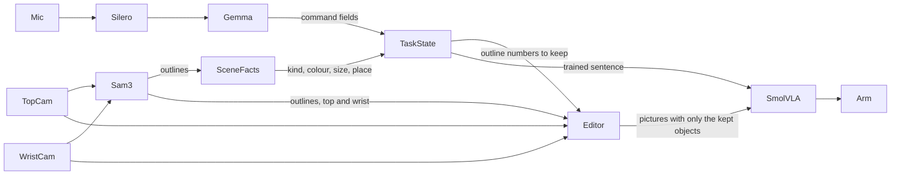

# Spec: voice-commanded picking and stacking with Gemma 4, SAM 3 and SmolVLA

Draft 1, 2026-11-21. Built so far: the voice client and its test
notebook (sections 4.6 and 5.1). Nothing else in this file is built. It follows from
`RESEARCH.md` (the literature and the test results) and from the user's
decisions of 2026-11-21. Measurements of this workshop stay in
`DEVELOPMENT_LEDGER.md` and `TESTING_LEDGER.md`.

Changed 2026-11-21, after 15:44, on the user's decision of 15:43: task 3
is driven by two commands, "learn the stack" and "rebuild the stack",
spoken or typed; the marker is parked (sections 1, 2, 5.1, 5.2, 8, 9 and
11). Section 4.1 has the plain program's result.

Changed 2026-11-21, after 15:59, on the user's requirement of 15:57: for
every command the user is shown the words Gemma understood and whether
it made a command of them (sections 2, 5 and 5.1). Section 4.4 has the
test of the two new commands; sections 9, 10 and 11 refer to it.

Changed 2026-11-21, after 16:01, on the user's word of 16:01: voice
control follows branch `gemma4-e4b-it_voice_intent` closely as the
working reference (sections 2, 5.1 and 11).

Changed 2026-11-21, after 16:06, on the user's word of 16:06: changing
the instructions to the model for additional commands is allowed and
required; task 1 reuses the branch's command `pick_place` (sections 2,
5.1, 6 and 11).

Changed 2026-11-21, after 16:14, on the user's requirement of 16:14:
every command is translated by Gemma 4 into a robot command or a tool
call, for example `pick_place(object: small red cube, place: box)`
(sections 2, 5.1 and 11). Tool calls were read up in the server's
source and in Google's page.

Changed 2026-11-21, after 16:24, on the user's answers to the question
form that followed: two ways of asking for the call were measured
(section 4.5; sections 5.1, 9, 10 and 11 refer to it); "stop robot"
also goes through Gemma only (sections 2, 5.1 and 11).

Changed 2026-11-21, after 16:31, on the user's answer to the question
form that followed the test: the call has the form of way 1, the
branch's request with its grammar extended by a place and an object of
up to three words (sections 2, 5.1 and 11).

Changed 2026-11-21, after 18:59, on the user's answers to the two
question forms on the commit plan: the Gemma client is in this workshop
as a copy of the branch's files, in `voice/` (sections 2 and 5.1;
section 11, decision 6). Section 4.6 has the voice test notebook and
its automated test. Section 10 has a weak point of the live voice
session with a long command; section 11 has it as decision 11.

Changed 2026-11-22, after 17:45, on the user's decisions of that
afternoon: SAM 3 runs through the reference `sam3-tracker-rocm` in a
Python environment of its own, without Docker, as a worker process of
this workshop; the plain PyTorch route is removed (sections 5.2 and 9,
measurement M4; section 11, decisions 2 and 3). Measurements are in the
ledgers and linked, not repeated.

Changed 2026-11-22, after 18:50, on the user's request of that evening
and the answers to two question forms: the three-cube test takes its
commands as sentences through Gemma 4, typed or in the synthetic voice,
and a program of this workshop reads the cube from Gemma's fields
(section 4.7; sections 5.3 and 6 amended; section 10 has a weak point
of the spoken form; section 11, decision 10 refers to it). Stacking
sentences are not part of it (the user: another use case, tested on
its own).

Terms used throughout:

- **VLA (vision-language-action model):** one neural network that takes
  camera pictures and a sentence and gives robot commands. Here it is the
  SmolVLA checkpoint `Harrysunshine/so101-smolvla-sim-real-10task`.
- **Gemma 4 E4B:** the language model, run on this machine's integrated
  graphics through the program `llama-server` of llama.cpp, which
  `scripts/setup_voice.sh` builds under `third_party/`.
- **SAM 3 (Segment Anything Model 3):** a model that outlines every
  object named by a text phrase in a picture and follows each outline
  through a stream of pictures.
- **Outline:** what SAM 3 returns for one object: which pixels belong to
  it, with a number that stays the same from picture to picture.
- **Twin:** the simulated SO-101 of this workshop (SAPIEN simulator).

## 1. The three tasks

1. Cubes, balls and cylinders of different colours lie anywhere on the
   table. A spoken command names one; the arm picks it up. The same
   object may be there twice, in the same size or in two sizes.
2. Stack cubes of different colours as commanded.
3. The arm is shown a stack of cubes and is told "learn the stack". The
   user scatters the cubes and says "rebuild the stack". The arm
   rebuilds the stack. Both commands can be spoken or typed. (Until
   2026-11-21, 15:43, a turned marker, a blue cylinder joined to a red
   cuboid, gave the two signals. That is parked.)

## 2. Decisions the user fixed on 2026-11-21

- The arm is moved by the VLA only. No pick by measured position and
  inverse kinematics.
- One language model: Gemma 4 E4B, as on branch
  `gemma4-e4b-it_voice_intent`.
- Segmentation is SAM 3, in the implementation
  [sam3-tracker-rocm](https://github.com/harrysungit/sam3-tracker-rocm).
- It is built in `workshops/so101-smolvla`; the Gemma server client is
  taken over from the Gemma branch, as a copy of its files in `voice/`
  (the user's answer to the question form on the commit plan; section
  5.1, "Where the client is"). Until 2026-11-22: see the last bullet of
  this section.
- Task 3 has two commands, "learn the stack" and "rebuild the stack".
  They can be spoken, or sent to Gemma 4 as text. The marker is parked
  (15:43).
- Voice control follows branch `gemma4-e4b-it_voice_intent` closely as
  the working reference; voice control is very stable there (16:01).
  What is taken over is taken over as it is. Anything that departs from
  the branch is named in section 5.1 and needs the user's word.
- Changing the instructions to the model (the prompt) to support
  additional commands, `learn_stack` and `rebuild_stack`, is allowed
  and required (16:06).
- Task 1, picking an object named by the user and placing it in the
  box, reuses the branch's existing command `pick_place` (16:06).
- Every command is translated by Gemma 4 into a robot command or a tool
  call (16:14). A robot command is a name alone (`learn_stack`,
  `home`). A tool call is a name with arguments, for example
  `pick_place(object: small red cube, place: box)`. No program in this
  workshop works out a command or its arguments from the user's words.
  Section 5.1, "Tool calls", has what was read; decisions 9 and 10.
- "stop robot" also goes through Gemma only: it is Gemma that makes the
  command `stop` of it. The branch's match of the phrase by a program
  is not taken over (question form after 16:14). This departs from the
  branch (5.1, departure 3).
- The call has the form of way 1 of section 5.1: the branch's request
  and grammar, the answer one object with the command as the tool's
  name and `object` and `place` as its arguments (question form after
  the test of section 4.5). Gemma's own tool-call form is not used.
- For every command, spoken or typed, the user is shown two things: the
  transcript, that is the words Gemma understood, and whether Gemma
  made a command for the robot of them, and which one. This holds for
  the new commands `learn_stack` and `rebuild_stack` as for the others
  (15:57). Section 5.1 says how.
- The Gemma server may run with two slots and a context of 4,096
  (15:03). Until 2026-11-22 not set in the client's copied
  `config/pipeline.yaml`, which kept the branch's one slot and 2,048;
  the notebook passed the two values when it started the server. Since
  then they are the settings in `configs/voice.json`.
- 2026-11-22, late evening (the user: "I do not want a dependency on
  vvla-pipeline"; models go to global caches): the workshop stands on
  its own. The client is this workshop's package
  `src/so101_smolvla/voice/`, run in `.venv`; `llama-server` is built by
  `scripts/setup_voice.sh` under `third_party/` (not in git); the two
  Gemma files live in the Hugging Face cache, the Silero model in its
  package `silero-vad`; no model file is in the workshop. The live
  microphone path stays; the utilization meters' NPU load test, which
  borrowed the other workshop's NPU runtime, goes. The rule of 16:01
  holds for what the model sees and hears (section 5.1); where the code
  lives and how it is run is this workshop's.

## 3. The principle

Something other than the policy decides which object is meant, and the
policy is shown only that object (`RESEARCH.md`, ["Main conclusion"](RESEARCH.md#r-main-conclusion) and
[Finding 8](RESEARCH.md#r-finding-8)). SmolVLA keeps what it is measured to do, moving the arm to
one object. Everything else on the table is painted over with table in
the pictures SmolVLA gets.

## 4. What was measured for this spec

### 4.1 Reading a stack and planning the rebuild from two pictures

12 rendered picture pairs (stack, then the same cubes scattered), one
question per pair, one scorer. Details and files: `RESEARCH.md`, section
["Unfinished"](RESEARCH.md#r-unfinished).

| Subject | Pairs fully correct | Pick points on the right cube |
|---|---|---|
| A large hosted model (the model of the Cursor session) | 12 of 12 | 42 of 42 |
| Gemma 4 E4B, about 136 tokens per picture (server as configured for voice) | 0 of 12 | 0 of 42 |
| Gemma 4 E4B, about 594 tokens per picture | 0 of 12 | 0 of 42 |
| Gemma 4 E4B, about 1,137 tokens per picture | 0 of 12 | 0 of 42 |
| A plain program, given the simulator's outlines of the cubes as a stand-in for SAM 3 (no colour, size or order with them) | 12 of 12 | 42 of 42 |

The plain program (`reader_program.py` in
`~/.cache/stack-memory-agent-test/`, job `reader-1795271945`) names the
colour by the hue inside an outline, the size by the outline's width or
area with the camera's calibration, and the order by height in the
picture. On the 36 development pairs it is also right in 36 of 36. Its
pick points lie on the outlines it was handed, so the 42 of 42 shows
that it matched each remembered cube to the right outline, not that it
found the cubes. Whether SAM 3's outlines are as good as the
simulator's is not measured.

### 4.2 The Gemma server with pictures

Read in `logs/gemma-12-pairs-1795262096.log` and
`logs/gemma-trial-1795261527.log` of `~/.cache/stack-memory-agent-test/`:

- A request with two pictures works on the existing server build and the
  existing model files. 36 of 36 requests were answered.
- The server was ready 2.0 to 6.1 s after its start.
- One request took 5.2 to 8.3 s at about 136 tokens per picture, 7.0 to
  10.2 s at about 594 and 10.2 to 13.3 s at about 1,137. The answers
  were 189 to 323 tokens long. In the one request whose timing was read
  (smallest picture size, 191 answer tokens), writing the answer took
  4.4 of the 5.4 s, at about 43 tokens per second.
- The two larger picture sizes need the server's context raised from
  2,048 to 4,096 tokens.

### 4.3 What follows from 4.1 and 4.2

- **Gemma 4 E4B does not read the scene.** In the plan this spec was
  written from, Gemma chose the target among SAM 3's outlines and read
  the stack. After 4.1 that is not the design. Colour, size and place of
  each object are measured by a program inside SAM 3's outline
  (section 5). This is a change from the approved plan and needs the
  user's word (section 11, decision 1).
- **Gemma keeps the two jobs it is measured or built for:** hearing the
  command, and turning it into a fixed set of fields.
- **Task 3 needs no model for memory or order.** The remembered stack is
  a list; the rebuild order is that list from the bottom up.
- Not tested, and listed as a measurement in section 9: Gemma 4 E4B on a
  picture with SAM 3's outlines drawn and numbered.
- One small question on a cut-out is measured (job
  `marker-gemma-1795271973`, the server's default picture size, each
  picture asked once, the answer forced into one of two words): which
  end of the marker is up. Gemma 4 E4B is right in 96 of 96 cut-outs
  around the marker and in 72 of 96 whole pictures. The marker itself is
  parked; the result says that a cut-out helps this model.

### 4.4 The two new commands, typed and spoken

Job `command-test-1795272820`, files in
`~/.cache/stack-memory-agent-test/command-test/`. A copy of the Gemma
branch's client (commit `1d231e1`) got the two commands by the three
changes of section 5.1 and nothing else. 20 sentences, each sent once
typed and once spoken (a synthetic voice, espeak-ng; the sentence in a
quiet clip of 6 s), the server with two slots and a context of 4,096.
Counted: sentences for which Gemma gave the expected command.

| Sentences | Typed | Spoken |
|---|---|---|
| "learn the stack", "rebuild the stack", word for word | 2 of 2 | 2 of 2 |
| The two commands in other words (8 sentences) | 7 of 8 | 7 of 8 |
| Commands the branch has today (6 sentences) | 6 of 6 | 6 of 6 |
| Sentences that are no command and must give none (4 sentences) | 4 of 4 | 2 of 4 |
| All | 19 of 20 | 17 of 20 |

- "save the stack" gave no command, typed and spoken.
- Spoken "do not rebuild the stack" came back with the transcript
  "rebuild the stack" and the command `rebuild_stack`. Spoken "who built
  this stack" came back with the transcript "rebuild this stack" and the
  command `rebuild_stack`. Typed, both gave no command.
- In both cases the transcript shows the user what was understood.
  That is what the requirement of section 5.1 is for.
- Limits: one synthetic voice, each sentence once, one complete clip per
  sentence. The microphone loop with its overlapping windows was not
  part of this test, and no person's voice.

### 4.5 `pick_place(object, place)` in two forms, typed and spoken

Job `tool-call-test-1795274571` (16:22:51 to 16:24:01, exit status 0),
script `tool_call_test.py` and files in
`~/.cache/stack-memory-agent-test/tool-call-test/`. 21 sentences, each
sent once typed and once spoken (espeak-ng, a quiet clip of 6 s), in
two ways on one server (two slots, context 4,096); 84 requests, all
answered.

- **Way 1, the branch's request with a grammar.** Client copy
  `gemma-branch-calls/`: the copy of section 4.4 plus a `place` field
  and an object of up to three words. Changed against that copy: the
  grammar (`config/intent.gbnf`: rules `root`, `obj`, new rule
  `place`), the instructions (`vla_pipeline/llm/intents.py`: the
  sentences on the answer's fields and the entry of `pick_place`), and
  three lines in the client that read `place`
  (`vla_pipeline/llm/llama_intent.py`).
- **Way 2, Gemma's own tool calls.** The request carries twelve tool
  definitions, one per command and named as the command, "a call is
  required", and no grammar. Every tool has the argument `heard`;
  `pick_place` also has `object` and `place`. The tools' descriptions
  are the entries of way 1's instructions. The server reports the model
  file's chat template as the one its Gemma 4 reader is chosen by, and
  every answer came back as one tool call.

Counted: sentences with the expected command; and for the eight
sentences whose expected command is `pick_place`, those with command,
object and place all as expected.

| | Way 1 typed | Way 1 spoken | Way 2 typed | Way 2 spoken |
|---|---|---|---|---|
| Picks with object and place (7 sentences): command | 7 of 7 | 7 of 7 | 7 of 7 | 7 of 7 |
| "learn the stack", "rebuild the stack" | 2 of 2 | 2 of 2 | 2 of 2 | 2 of 2 |
| Commands the branch has today (6 sentences) | 6 of 6 | 5 of 6 | 6 of 6 | 5 of 6 |
| Sentences that are no command (6 sentences) | 6 of 6 | 3 of 6 | 5 of 6 | 3 of 6 |
| All: command | 21 of 21 | 17 of 21 | 20 of 21 | 17 of 21 |
| `pick_place` with object and place right (8 sentences) | 8 of 8 | 7 of 8 | 8 of 8 | 8 of 8 |
| Answers that carry the heard words | 21 of 21 | 21 of 21 | 21 of 21 | 21 of 21 |
| Seconds per request: least, middle, most | 0.56, 0.67, 1.49 | 0.74, 0.86, 1.24 | 0.41, 0.51, 1.88 | 0.57, 0.72, 1.18 |

- "pick up the small red cube and put it in the box" gave
  `pick_place` with object "small red cube" and place "box" in all four
  columns.
- The one wrong argument: spoken "take the small blue cube to the bin",
  way 1, came back with place "bed" and the transcript "take the small
  blue cube to the bed".
- Wrong in both ways when spoken, the same four sentences: "show me
  your best dance moves" gave no command, with the transcript right;
  "do not rebuild the stack" and "who built this stack" gave
  `rebuild_stack`; "the red cube is in the box" gave `pick_place` with
  "red cube" and "box".
- Way 2, typed "do not rebuild the stack" gave `stop`. Way 2, spoken,
  the same sentence came back with the transcript "Do not rebuild the
  stack" and the command `rebuild_stack`.
- Spoken "show me your best dance moves" gave `dance` in the test of
  section 4.4, with the instructions before the `place` field
  (`command-test/result.json`). The cause is not settled: the
  instructions differ, and the two tests' clips of the sentence are
  not the same sound either (the files differ from the first spoken
  sample on; why the same synthetic voice gave two sounds was not
  looked into).
- "stop robot" gave `stop` in all four columns.
- Size of a request: way 2's requests had 1,271 to 1,281 prompt tokens
  typed and 1,431 spoken (`result.json`); way 1's first typed request
  had 678 tokens processed with nothing kept from before
  (`llama-server.log`, line 17). Later requests reuse the kept
  beginning: in the next five requests of way 1 the server processed
  12 tokens for each typed and 167 for each spoken one (same log,
  lines 24 to 52).
- Limits as in 4.4: one synthetic voice, each sentence once, one
  complete clip per sentence, no microphone loop. The transcripts were
  not scored.

### 4.6 The voice test notebook and its automated test

`notebooks/voice_control_test.ipynb` shows, for a typed or spoken
sentence, the transcript and the call (`you:` and `->`), through this
workshop's client (`so101_smolvla.voice`, since 2026-11-22; before, the
copy in `voice/`) with the form of way 1. Its table has 30 sentences:
the 21 of section 4.5 and 9 more from the branch's own list
(`CLIENT_CASES` in `so101_smolvla/voice/examples.py`). Its sections 6
and 7 are for a person at the microphone: one recorded clip, and the
live voice session (`microphone.py`).

`tests/test_voice_notebook.py` runs the notebook through its Jupyter
kernel against the real server (two slots, context 4,096) and leaves
out the two cells that need a person. Counted: sentences whose call is
as expected, that is the command, and for `pick_place` also the object
and, where the table names one, the place. Three runs on 2026-11-21
(jobs `voice-notebook-test-1795283427`,
`voice-notebook-outputs-1795283510`, `so101-full-suite-1795283609` in
`~/.cache/stack-memory-agent-test/logs/`):

| | Typed | Spoken, synthetic voice (espeak-ng, one 6 s clip per sentence) |
|---|---|---|
| Sentences with the expected call, each of the three runs | 30 of 30 | 26 of 30 |
| Seconds per request in the run whose outputs the notebook stores: least, middle, most | 0.55, 0.69, 1.00 | 0.74, 0.87, 1.19 |

- The test requires the typed count to be complete. The spoken count
  is printed and not required (the user's answer to the question form
  on the commit plan).
- The four spoken sentences that were wrong in the run whose outputs
  the notebook stores: "hold this pencil for me" came back with the
  transcript "pick up this pencil for me" and `pick_place` with
  "pencil"; "do not rebuild the stack" and "who built this stack" gave
  `rebuild_stack`; "the red cube is in the box" gave `pick_place` with
  "red cube" and "box". Which four were wrong in the other two runs
  was not printed.
- A second test in the same file: with a microphone name that does not
  exist, the live-session cell stops with an error, and a second start
  of the server on the same port is refused.
- Limits: the spoken column is one synthetic voice and one complete
  clip per sentence. No count has been taken with a person's voice or
  through the live session.

### 4.7 Sentences through Gemma to the three-cube test

Built 2026-11-22, evening. The three-cube test of [Finding 8](RESEARCH.md#r-finding-8)
(`RESEARCH.md`) takes its three commands per layout as sentences: each
goes to Gemma 4 through the voice client (`so101_smolvla.voice`; until
2026-11-22 the copy in `voice/`), typed (the client's `parse`) or said
by the synthetic voice as one 6 s clip (its `parse_audio`), right
before its pick. Gemma's fields come back as
they are; `src/so101_smolvla/cube_commands.py` reads the cube from
`command` and `object` alone, in one place: a `pick_place` whose object
names exactly one of red, green and blue, and no other kind of thing,
is that cube; anything else is refused with its reason and moves
nothing. The `place` field is recorded and not judged (section 6: a
pick ends in the bin; a cube named as the place is the stacking case,
decision 9, tested on its own on the user's word). The client
(`so101_smolvla.voice.commands.VoiceCommands`) runs in the main process
and starts its own Gemma server on the runner's port of
`configs/voice.json` (8083), so a server the user runs on the default
port (8082, the notebook's) is left alone; until 2026-11-22 it ran as a
worker process in the other workshop's environment. The runner's
switches are `--sentences
built-in` (ten phrasings per colour, section of `cube_commands.py`) or
a file of sentences, and `--spoken`.

Measured (detail: [`TESTING_LEDGER.md`](TESTING_LEDGER.md#t-2026-11-22-gemma-commands);
meaning: [`DEVELOPMENT_LEDGER.md`](DEVELOPMENT_LEDGER.md#d-2026-11-22-gemma-commands)):
typed, every one of the 30 pick sentences gave its cube and every one
of the 7 sentences that should move nothing was refused; in the
synthetic voice, 34 of the 37, and two of the three misses are a
question and a negation that became a pick of the red cube (section
10). The ten-layout run with typed sentences is in the testing ledger.

### 4.8 The live demo notebook, on the same pick-and-place loop

Built 2026-11-23. The user's rule: the pick-and-place logic is one
piece of code, used by the tests and the notebook alike. So the
per-command loop that lived inside the runner's layout function is
`src/so101_smolvla/pick_place.py` (`PickPlaceScene`: one scene, one
policy, the outlines' source; `start_layout` once, `run_command` per
command, never a reset between commands; an `Observer` hears of every
plan and every step). `three_cube_rollout.run_three_cube_episode` runs
on it and writes the episode folder from its record; checked by
rerunning layout 0 by typed sentences: every joint target of the 1,200
steps identical to the run of 2026-11-22, 22:45, the records identical
apart from their timing fields (`TESTING_LEDGER.md`, the section of
2026-11-23).

`notebooks/pick_place_demo.ipynb` drives that loop with a person at the
microphone: `so101_smolvla.demo.DemoSession` owns the state the picture
is drawn from (an immutable snapshot replaced whole, the transcript,
the voice level, one "changed" event) and one worker thread that runs
requests one at a time with at most one waiting behind it; a typed
sentence is given to Gemma on that thread, a spoken one arrives with
Gemma's fields from the `Listener`; a new layout is a request too, so
only the worker touches the scene. `demo_console.compose` draws the six
tiles of the feeds video (the same `feeds_video` functions) and a panel
with the voice meter (the frame level, green while Silero counts it as
speech, red after 2 s without a frame), the transcript, the command's
progress and the gripper: the jaw opening the simulator reports (0 to
100 % of travel), green while a jaw touches the target cube, "grasped"
while it holds it. The twin measures no gripper current or force, so
none is shown (decision of 2026-11-23). `demo_view.DemoView` shows the
picture in one `ipywidgets.Image`, redrawn by a thread that blocks on
the "changed" event and draws at most ten times a second; the cell
returns, the text box and the buttons are widget callbacks. Not taken
from the reference console of the other workshop: its fixed-rate redraw
loop that blocks the kernel, its polled gripper value, its locked
shared fields, its JSON round trip of commands, and its servo current
computed from an effort this twin has not got.

## 5. Parts and what each one owns

Each fact has one owner. No part keeps a copy of another part's fact.

| Part | Owns | Runs where |
|---|---|---|
| Voice | The spoken command as fields: what to do, which object (kind, colour), size word, place word; and the transcript, the words Gemma understood. One Gemma request per speech window, constrained by a grammar file, as today | Gemma server (`llama-server`), Silero speech detection on the processor |
| SAM 3 service | The outlines, per camera, with numbers that persist | `sam3-tracker-rocm` in its container |
| Scene facts | For each outline: kind (the phrase SAM 3 found it by), colour (hue inside the outline), size class (outline area with the camera's calibration), place on the table | A program in this workshop |
| Task state | The command being carried out, the chosen outline number, the remembered stack, the list of moves and which one is current | A program in this workshop, in memory |
| Picture editor | The two pictures SmolVLA gets | A program in this workshop |
| SmolVLA | The arm's motion | This workshop's `.venv`, as today |
| Checker | Whether a move is done: a fresh set of scene facts after the arm has stopped | The scene-facts program |

### 5.1 Voice

- Taken over from branch `gemma4-e4b-it_voice_intent`:
  `vla_pipeline/llm/llama_intent.py` (server start, readiness, request),
  `vla_pipeline/llm/voice.py`, `vla_pipeline/audio/gemma_listen.py`,
  `config/intent.gbnf`, the section `gemma4-e4b-it` of
  `config/pipeline.yaml`.
- Where the client is (the user's answer to the question form on the
  commit plan; decision 6): a copy in `workshops/so101-smolvla/voice/`.
  Commit `6cc7eae` holds eleven files of the branch's commit `1d231e1`
  unchanged (1,192 lines: the files named above, with
  `vla_pipeline/llm/intents.py`, `vla_pipeline/utils/config.py`, the
  whole `config/pipeline.yaml` and the packages' `__init__.py` files).
  Commit `a185898` holds this workshop's changes to four of them (33
  lines added, 10 removed): `learn_stack` and `rebuild_stack`, the
  `place` field and the object of up to three words. Not copied: the
  branch's dispatcher, console and main program
  (`vla_pipeline/dispatch.py`, `console.py`, `main.py`). Not in git and
  used from the set-up voice workshop `workshops/vvla-pipeline` on the
  same machine: its Python environment, `llama-server`, the two model
  files and the speech-detection model
  (`voice/notebook_tools.py:38-40` and `:85-93`). That was the state
  until 2026-11-22.
- Where the client is since 2026-11-22 (the user: no dependency on
  `vvla-pipeline`; large models in global caches): the package
  `src/so101_smolvla/voice/`, run in the workshop's `.venv`, with its
  settings in `configs/voice.json`. What came from where: `intents.py`
  from `vla_pipeline/llm/intents.py` (the commands, the instructions,
  one answer; the keyword stand-in and the handler registry, unused
  here, left out); `intent.gbnf` as it was; `server.py` and `client.py`
  from `llama_intent.py` (the server start, its readiness line and the
  two requests; the `autostart`, `ubatch_size`, `cu_mask` and
  `extra_args` settings, unused here, left out); `microphone.py` from
  `voice.py` and `audio/gemma_listen.py` (the listening loop, Silero,
  the windows and the filter; the request thread now ends on a queue
  sentinel instead of polling its queue); `speech.py` and `examples.py`
  from `notebook_tools.py`; `settings.py` and `configs/voice.json` from
  `utils/config.py` and the `gemma4-e4b-it` section of
  `pipeline.yaml`. Not in git: `llama-server`, built by
  `scripts/setup_voice.sh` from llama.cpp commit `781dbc5ac` for
  `gfx1100` under `third_party/`, without the server's web page; the two
  Gemma files, in the Hugging Face cache (`ggml-org/gemma-4-E4B-it-GGUF`,
  Q4_0 and the Q8_0 audio projector, never downloaded at run time). The
  Silero model is the file the package `silero-vad==6.2.3` ships, the
  same bytes as before. The graphics override is set in the environment
  of the server process only. The worker process and its launcher are
  gone: the client is asked in the main process.
- The rule (user, 2026-11-21, 16:01): the branch is the working
  reference and is followed closely. The listening loop, the speech
  detection, the windows, the filter for repeated commands, the server
  start, the request, the instructions to the model, the grammar and
  the console lines are the branch's, unchanged. A command is added the
  branch's own way (the bullet "A new command is three changes" below)
  and in no other way. Since 2026-11-22 the rule holds for what the
  model sees and hears: the instructions, the grammar, the two request
  bodies, the clip, the listening parameters and the filter are the
  branch's in effect; the code's home and the way it is run are this
  workshop's (the bullet above).
- Departures from the branch, each needing the user's word:
  1. Two server slots and a context of 4,096 instead of one slot and
     2,048. Accepted by the user at 15:03 (section 2); measured with
     the branch's own voice session: the same 10 of 12 commands
     delivered with and without picture requests
     (`DEVELOPMENT_LEDGER.md`, section of 2026-11-21 on the voice
     loop).
  2. More in Gemma's answer than the branch has: a `place` field and
     an object of up to three words, in the branch's own request and
     grammar (way 1 under "Tool calls" below). Accepted by the user
     after the test of section 4.5. A second object for stacking is
     not decided (decision 9).
  3. "stop robot" is made a command by Gemma only. The branch also
     matches the phrase by a program, in typed text before Gemma is
     asked and in the text of Gemma's answer
     (`vla_pipeline/main.py:209-218`, called at
     `vla_pipeline/dispatch.py:96`). The user's word after 16:14: not
     taken over. What it means for the time to a stop is not measured;
     a typed or spoken "stop robot" then takes one Gemma request (0.41
     to 0.74 s in the four requests of section 4.5, an idle server).
     Measurement M6.
- The grammar file today allows ten commands and an object of at most
  two words (`config/intent.gbnf`). Draft 1 of this spec extended it to
  more fields: command (pick, stack, learn the stack, rebuild the
  stack, stop, home, unknown), object kind, colour, size word, place
  word, and for stacking a second object. Under the rule of 16:01 this
  is not done without the user's word. The user's word after the test
  of section 4.5: the answer is the branch's with one more field,
  `{"command", "object", "place", "heard"}`; the object holds up to
  three words ("small red cube"), the place up to two ("box"); the
  commands are the branch's plus `learn_stack` and `rebuild_stack`.
  Colour and size are words of the object field, not fields of their
  own.
- Task 1 uses the branch's command `pick_place` and its object field
  (`vla_pipeline/llm/intents.py:38` and `:176-178`, commit `1d231e1`).
  In the test of section 4.4 "pick up the ball" gave `pick_place` with
  the object "ball", typed and spoken. Reused: the command's name, its
  place in the grammar and the object field. Not reused: the handler.
  On the branch the command runs a pick with an object detector and a
  scripted motion (`vla_pipeline/main.py:130-149`); here this workshop
  registers its own handler for the same command, which is section 6.
  Two limits, neither measured: the object field holds at most two
  words (`config/intent.gbnf`, rule `obj`), so "small red cube" does
  not fit, while the transcript carries all the words; and the branch's
  instruction line for the command speaks of picking up and handing
  over, not of a box, so whether "put the red cube in the box" gives
  `pick_place` with the object "red cube" is not tested.
- A typed command takes the same way as a spoken one: the client has an
  entry for text and one for a sound clip, and both send one request
  with the same instructions and the same grammar
  (`vla_pipeline/llm/llama_intent.py:248-261` on the branch).
- A new command is three changes, as the branch's own notes say
  (`vla_pipeline/llm/intents.py:13-17`): its name in the list of
  commands, one line in the instructions to the model, its name in the
  grammar file.
- "stop robot" stays the only spoken stop. Gemma makes the command
  `stop` of it, by the entry for `stop` in the instructions
  (`vla_pipeline/llm/intents.py:188-189` on the branch); the branch's
  match of the phrase by a program is not taken over (departure 3).

**What the user is shown (requirement of 2026-11-21, 15:57).** For every
command, spoken or typed, the user sees:

1. the transcript: the words Gemma understood;
2. whether Gemma made a command for the robot of them, and which one
   (`learn_stack` and `rebuild_stack` included), or that it made none.

The branch has this, and it is taken over with the client (file and line
as in commit `1d231e1`):

- Gemma's answer carries the words beside the command: the instructions
  ask for `{"command", "object", "heard"}`, where "heard" is "the words
  the person said to the robot" (`vla_pipeline/llm/intents.py:165-169`);
  the client keeps them as the command's transcript
  (`vla_pipeline/llm/llama_intent.py:238-246`).
- The voice thread hands on command, object and heard words together
  (`vla_pipeline/llm/voice.py:126-130`).
- The dispatcher reports `heard` with the transcript and `parsed` with
  the command (`vla_pipeline/dispatch.py:91` and `:205`). The console
  window writes them as two lines, `you: <transcript>` and
  `-> <command>` (`vla_pipeline/console.py:390-392` and `:398-400`).
- The transcript and the command come from the one answer of Gemma. No
  second place works out what was said.
- The command is carried out right after the line `-> <command>`
  (`vla_pipeline/dispatch.py:205-229`); there is no confirmation step.
  The user who sees a wrong line ends it with "stop robot".

One case the branch does not show: a spoken window of which Gemma made
no command is dropped before the dispatcher
(`vla_pipeline/audio/gemma_listen.py:62-64`,
`vla_pipeline/llm/voice.py:122-125`), so neither its transcript nor "no
command" appears. A typed text that gives no command is shown, as
`-> unknown`. Under the rule of 16:01 this stays as the branch has it
(decision 8).

**Tool calls (requirement of 2026-11-21, 16:14; read, nothing run).**
The aim is an answer such as
`pick_place(object: small red cube, place: box)`. Read in the server's
source (llama.cpp commit `781dbc5ac`, then the other workshop's build,
since 2026-11-22 built here under `third_party/llama.cpp`) and in
Google's page
[Gemma prompt formatting](https://ai.google.dev/gemma/docs/core/prompt-formatting-gemma4):

- Gemma 4 is trained to call tools. Its own form is
  `<|tool_call>call:pick_place{object:<|"|>small red cube<|"|>,place:<|"|>box<|"|>}<tool_call|>`
  (Google's page, "Function Calling"). The server has a reader for
  exactly this form (`common/parsers/gemma4.cpp:220-273`) and hands the
  call on as a name and its arguments.
- The branch's request today carries a grammar and no tool definitions
  (`vla_pipeline/llm/llama_intent.py:207-215`). The server refuses a
  request that has both (`tools/server/server-common.cpp:1394-1398`).
- With tool definitions the server holds Gemma to the listed tool names
  (`gemma4.cpp:263-266`). It does not hold the arguments to the tool's
  description: any names and values pass (`gemma4.cpp:260-261`, a note
  that this is still to do). With the setting "a call is required" the
  answer must be a tool call (`gemma4.cpp:271`, `:275-277`, `:294`);
  without it Gemma may answer in free text.
- The model file on this machine carries the chat template the
  server's reader is chosen by (`common/chat.cpp:1194-1201`; the
  server's own report in the log of job `tool-call-test-1795274571`).

Three ways to get the call. Ways 1 and 2 are measured (section 4.5);
way 3 is not:

1. **The branch's request, the grammar written as calls.** The answer
   stays one object, `{"command": ["pick_place"](DEVELOPMENT_LEDGER.md#d-2026-11-21-pickplace-object-place-in-two-forms), "object": "small red
   cube", "place": "box", "heard": "..."}`; the command is the tool's
   name and the other fields are its arguments. Changed: the grammar
   rule for the object (three words), one new field for the place, the
   instruction line of `pick_place`. The grammar holds names and values.
   Request, reading of the answer, transcript and console stay the
   branch's.
2. **Gemma's own tool calls.** The request carries tool definitions and
   no grammar. Departures from the branch: the request; the answer is
   read from the call, not from the text
   (`llama_intent.py:225-229` reads the text); the transcript has to be
   an argument of every tool; "no command" has to be a tool of its own;
   the arguments are not held by a grammar in this server build.
3. **A schema in the request instead of the grammar file.** The server
   makes the grammar from the schema (`gemma4.cpp:213-218`). The same
   answer as way 1, with a changed request.

What section 4.5 says about ways 1 and 2: both give the call with the
right object and place for the pick sentences, typed (8 of 8 each) and
spoken (7 of 8 and 8 of 8). Both miss the same four spoken sentences.
Way 2's request is about twice as long and its answers were not
slower. Neither way is better at leaving a spoken non-command alone (3
of 6 each).

### 5.2 SAM 3 service

- The reference's live interface: one object `SAM3Live`, built once,
  then `infer(picture)` per picture; it returns object numbers, scores,
  one outline and one box per object, and which phrase found which
  object (`tracker/live_inference.py:65-72` and `:806-838` in the local
  checkout, version 0.2.0-rc4).
- It is asked by phrases, not by boxes. The phrases are the object kinds
  of the task ("cube", "ball", "cylinder").
- It keeps at most five objects per phrase unless told otherwise
  (`max_objects_per_prompt`, same file, line 90).
- One `SAM3Live` object is "single-threaded, single resident session".
  Two cameras therefore need two sessions or one session used in turns.
  Which, and what it costs, is measurement M4.
- Its published speed is for one object and one stream: 89.77 to
  90.15 ms per picture on this processor class (the author's runs,
  release v0.4.0-rc1). Not measured here.
- How the outlines leave the container is decision 2 in section 11.
  Whatever is chosen is one-way, bounded, and drops the oldest picture
  when a newer one waits; it never makes the control loop wait.

**Amendment, 2026-11-22, after 17:45, to this section.** The service is
built and in use for the three-cube test; the bullets above describe the
reading of 2026-11-21. As built: there is no container. The reference
(v0.4.0-rc1, commit `8005dc6`, the address of the user's link) is checked
out beside the repository, its model files are compiled at 504 pixels
without Docker, and it runs in the Python environment `.venv-sam3`
(`scripts/setup_sam3_env.sh`), started through
`scripts/run_sam3_reference.sh`, which also sets the one setting the
convolution library needs on this machine. The worker
(`src/so101_smolvla/sam3_worker.py`) is a process of this workshop,
asked over two pipes by `src/so101_smolvla/sam3_outlines.py`; it holds one
`SAM3Live` per camera, so two cameras are two sessions, runs the full
detection on every call, and caps no number of objects (the "at most
five" above is the reference's default and is switched off). Measured
(M4, answered): 0.29 s per top picture and 0.32 s per wrist picture, 640
by 480, median over 240 plans, against 6.9 and 9.2 s for the PyTorch
route; the two routes outline the same cubes in 250 of 254 pairs on
stored pictures; the test's result is the same on the same ten layouts
(9 of 10). Detail: [`TESTING_LEDGER.md`](TESTING_LEDGER.md#t-2026-11-22-fast-sam3-run)
and the two sections before it; meaning:
[`DEVELOPMENT_LEDGER.md`](DEVELOPMENT_LEDGER.md#d-2026-11-22-fast-sam3).
Not measured: the reference's own demo, and SAM 3 on balls and
cylinders ("cube" is the only phrase in use).

### 5.3 Scene facts and choosing the target

- For every outline of the top picture: kind from SAM 3's phrase, colour
  from the hue inside the outline, size class from the outline's area
  brought to the table's scale with the camera's calibration, place from
  the outline's centre on the table plane.
- The target is the one outline whose facts fit all fields of the
  command. A place word ("left", "nearest") is decided on the places.
- If two outlines fit and the command has nothing that tells them apart,
  the system asks back by voice and does not move. If none fits, it says
  so and does not move.
- The decision is made in the task state in one call, from the scene
  facts it is handed; the caller does not combine queries.

  Amendment, 2026-11-22, after 18:50: built for the three-cube scene of
  the test in the form of section 4.7. There the scene has three cubes
  of three colours and the facts are the colours, so the one call is
  `cube_commands.choose_cube(command, object)`: one colour named, that
  cube; no colour, two colours, another kind of thing or another
  command, a refusal with its reason and no movement. It asks nothing
  back yet (no voice out) and reads no size or place.

### 5.4 Picture editor

- Input: the camera's picture, SAM 3's outlines for that camera, and the
  outline numbers to keep (the target; for stacking also the cube it
  goes onto).
- It paints table over every other outline, widened by a few pixels, and
  leaves the arm and the kept objects untouched.
- The paint is a picture of the empty table as that camera sees it, not
  black and not one colour. The top picture uses a stored picture of the
  empty table. The wrist picture uses that same picture drawn as the
  wrist camera sees it; the function exists
  (`src/so101_smolvla/table_view.py`, `table_seen_from`).
- When SAM 3 no longer reports the target in a picture, the editor does
  not guess: the task state stops the arm and takes a fresh look.
- The policy is called in two places today: `select_action` in
  `src/so101_smolvla/policy.py:27-52` (demo and evaluation) and
  `_action` in `src/so101_smolvla/sapien_rollout.py:77-100` (the twin's
  test runs). The editor is one function that changes the top and the
  wrist picture before either call. Making the two calls one is
  decision 5.

### 5.5 SmolVLA

- Unchanged checkpoint, not retrained at first.
- It is given one of its trained sentences, chosen by the task state,
  not the user's words. The trained sentences that matter here
  (`README.md`, table "Models evaluated"):
  `Pick up a cube and place in the bin`,
  `Pick up a small cube and place in the bin`,
  `Stack the smaller cube on the larger one`.

## 6. Task 1: pick the named object

1. Voice gives the branch's command `pick_place` with the object the
   user named (5.1).
2. A fresh set of scene facts; the task state chooses the target or asks
   back (5.3).
3. The editor keeps the target and paints over the rest, in both
   pictures, for every control step.
4. SmolVLA runs with the pick sentence that fits the target's size.
5. When the arm has stopped, the checker takes a fresh look and reports
   done or not done.

What the checkpoint is trained to do with a picked object is to put it
into the bin. "Pick" in this spec therefore ends in the bin. Balls and
cylinders were never run with this checkpoint (measurement M7).

Amendment, 2026-11-22, after 18:50: steps 1 to 4 run in the twin for
three cubes of three colours (section 4.7): the sentence through Gemma,
the cube from its fields, the other two cubes painted over by SAM 3's
outlines, SmolVLA with its trained sentence. Step 5, the checker, is
the simulator's own rule for a placed cube in the test, not a fresh
look at the scene.

## 7. Task 2: stack cubes as commanded

1. Voice gives the cube to move and the cube to put it on, or a whole
   order ("red on blue on green"), which the task state turns into
   single moves, bottom first.
2. For each move: fresh scene facts; the editor keeps the cube to move
   and the cube (or stack) it goes onto; SmolVLA runs with the stacking
   sentence; the checker looks.
3. A move that the checker reports as not done is tried again once, then
   the system stops and says which move failed.

## 8. Task 3: rebuild a remembered stack

1. Two commands, spoken or typed: "learn the stack" and "rebuild the
   stack". Voice hands them to the task state as command fields like
   every other command.
2. Learn: the scene facts of the stack, from the bottom up, go into
   the task state as a list of colour and size class. This is what
   `learn()` does in `~/GitHub/VLA-VLM`
   (`arm/planner/armpi_builder.py:1070-1092`); its input there comes
   from a depth camera, here from SAM 3's outlines.
3. Rebuild: the list is the order of the moves. Each move is task 2's
   single move. A rebuild command with nothing learned is answered with
   that, and the arm does not move (as in `VLA-VLM`, same file, line
   1547).
4. Two cubes that are the same in colour and size are interchangeable;
   the task state takes either.

Parked: the marker (a blue cylinder joined to a red cuboid) whose upper
end gave the two signals. If it comes back, its two ends are two more
phrases for SAM 3 and the higher outline is the end that is up.

How a standing stack is read level by level from SAM 3's outlines (cubes
of one colour that touch, a small cube on a large one) is not measured;
it is part of measurement M1.

## 9. First phase: measurements before anything is built on

All in the twin. A count is written "k of n". Every pass count below is
a proposal; the user sets it (decision 4). A measurement that fails is
reported with its count and decides the next step named in its row.

| | What is measured | Proposed pass | If it fails |
|---|---|---|---|
| M1 | Done with the simulator's outlines: a plain program reads the 12 stack pictures of section 4.1 and plans the rebuild, 12 of 12. Open: the same reading from SAM 3's outlines | 12 of 12, as the hosted model | The stack is read level by level while it is taken apart, not from one picture |
| M2 | SmolVLA with the other objects painted over, using the simulator's own outlines: one 40 mm cube and three other objects, bin sentence, 10 layouts. Beside it the same layouts with unedited pictures | At least 9 of 10 (the cube alone: 10 of 10) | The paint is examined first (table picture, wrist picture); then fine-tuning on edited pictures |
| M3 | The same with SAM 3's outlines, top and wrist | At most one layout fewer than M2 | The wrist picture is edited from the top camera's outlines and the calibration, or left unedited, and measured again |
| M4 | `sam3-tracker-rocm` on this machine: its own demo; then the twin's pictures with the number of objects of our scenes and both cameras: results per second, and in how many pictures an object is lost | Reported, no pass count; M3 decides | – |
| M5 | Gemma server, SAM 3 and SmolVLA running together on the integrated graphics: memory in use and time per control step, against SmolVLA alone | Reported; the pass value is the user's | The order of work in a control step is changed before any model is changed |
| M6 | Time from the end of a spoken "stop robot" to the arm standing still, with all parts running, against voice alone | No slower than voice alone by more than 0.5 s | Voice gets the graphics chip first; SAM 3 skips pictures |
| M7 | The unchanged checkpoint on what it was not trained for: a ball and a cylinder into the bin; two cubes of one size stacked; a third cube onto a stack of two | Reported. Known: 24 of 60 for its one trained stacking pair | Stacking is fine-tuned before tasks 2 and 3 are built |
| M8 | Gemma turns typed and spoken commands for the three tasks into the extended fields. Done for "learn the stack" and "rebuild the stack" beside the commands it has today: typed 19 of 20, spoken 17 of 20 (section 4.4). Done for `pick_place` with object and place in two forms: object and place right in 8 of 8 typed in both, spoken 7 of 8 with the grammar and 8 of 8 as Gemma's own tool call (section 4.5). Open: a second object for stacking; the same sentences in a person's voice through the microphone loop (the notebook of section 4.6 has the cells for it; no count taken); that the transcript and the command of each are shown (section 5.1) | Reported per field, against written expected fields | The grammar is narrowed |
| M9 | Optional: Gemma chooses an object in a picture with SAM 3's outlines drawn and numbered, for commands the scene facts cannot settle ("the cube next to the ball") | Reported | Such commands are answered with a question back |

Order: M1 and M2 first, because they need neither SAM 3 nor Gemma and
decide whether the principle holds for this checkpoint. Then M4, M3, M7,
M5, M6, M8.

Amendment, 2026-11-22, after 17:45, to the rows M2, M3 and M4. Measured
on 2026-11-22 in a three-cube form (three 40 mm cubes and a bin, one
command per cube, 10 layouts): M2 with the simulator's outlines 7 of 10
layouts against 0 of 10 unedited; M3 with SAM 3's outlines 9 of 10, with
the PyTorch route and with the reference alike; M4 as in the amendment of
section 5.2. Pass counts are still the user's (decision 4). Detail:
[`TESTING_LEDGER.md`](TESTING_LEDGER.md#t-2026-11-22-fast-sam3-run) and
[`RESEARCH.md`, Finding 8](RESEARCH.md#r-finding-8).

## 10. Known weak points

- Stacking with this checkpoint stands at 24 of 60 in the twin, for the
  one pair it was trained on (red 20 mm cube on a 40 mm cube). Tasks 2
  and 3 depend on it.
- The wrist camera. The one published method that edits a wrist picture
  reports objects lost by the tracker there (`RESEARCH.md`, [Finding 8](RESEARCH.md#r-finding-8)).
- Removing objects is not always a gain: in one published test it made
  the policy worse (same finding).
- The published tests of painting objects over used other policies and
  other arms. Nothing of it is measured with SmolVLA or an SO-101.
- SAM 3's published speed is for one object and one picture stream.
- Gemma 4 E4B did not read the scene in the one test made (4.1).
- Two of four spoken sentences that are no command were understood as
  "rebuild the stack" (4.4, a synthetic voice). The arm would start.
  What the user has against it is the shown transcript and command
  (5.1) and "stop robot".
- In the test of 4.5, three of six spoken sentences that are no command
  were made a command in either form: again the two above, and "the
  red cube is in the box", which gave `pick_place` with "red cube" and
  "box". One spoken command of the branch ("show me your best dance
  moves") gave no command there.
- In the synthetic voice, a question ("is the red cube in the box",
  heard as "This red cube in the box") and a negation ("do not pick up
  the red cube", heard right) became `pick_place` with "red cube"; the
  program that reads the cube sees only Gemma's fields and would move
  the red cube. Typed, both are "unknown" as the instructions ask. The
  test that holds this (`tests/test_gemma_cube_commands_integration.py`,
  the spoken test) asserts that no sentence moves a cube it does not
  name and so stays red, on the user's word, until the audio path is
  fixed; the audio request is the branch's (5.1) and a change to it
  needs the user's word. Section 4.7.
- With "stop robot" going through Gemma only (5.1, departure 3), a stop
  depends on Gemma hearing it and takes one Gemma request. How long
  that is while the arm moves and the other models run is not measured
  (M6).
- A command that takes longer to say than one hop of the live voice
  session can lose what is said last. The session sends the last 6 s
  of sound to Gemma every 2 s in which it hears speech (`hop_s` and
  `window_s` in `configs/voice.json`; `HopWindows.feed` in
  `src/so101_smolvla/voice/microphone.py`), so the first window with
  speech can hold only the beginning of a sentence. Once Gemma has made
  a command of a window, the same command is refused from every later
  window that overlaps it and for 5 s (`CommandFilter.accept` and
  `Listener._request` there; `cooldown_s` in the settings). The filter
  compares the command's name, not its
  arguments. Seen in one stored run: "pick up the small red cube and
  put it in the box", 3.2 s long in the synthetic voice, played into
  the live session (job `notebook-kernel-1795276154`; its outputs are
  in Jupyter's autosave copy
  `notebooks/.ipynb_checkpoints/voice_control_test-checkpoint.ipynb`,
  which is not in git). The session showed "pick up the small red
  cube" and `pick_place` with "small red cube", without the place, and
  nothing after it. The later windows were not logged, so that they
  were refused is read from the code, not seen. Not tested with a
  person's voice. The loop and the filter are the branch's in what they
  do (commit `6cc7eae`; since 2026-11-22 in `microphone.py`, 5.1). One
  complete clip, as in section 4.5 and in the
  notebook's section 6, is not affected. Decision 11.
- Everything here is for the twin. Nothing is measured on the real arm.

## 11. Decisions that are the user's

1. **Gemma does not read the scene** (4.3). Confirm, or name what Gemma
   should still look at; M9 is the measurement for that.
2. **How the outlines leave the SAM 3 container.** Three ways: a small
   service inside the container that this workshop talks to over a local
   socket; ROS 2, for which the reference ships a node skeleton and
   which this workshop does not use today; or SAM 3 through the
   `transformers` package in this workshop's `.venv`, without the
   container and without its speed-up (not measured).
3. **Which version of the reference.** The checkout at
   `~/GitHub/sam3-tracker-rocm` is 0.2.0-rc4 with its model files built.
   The linked release v0.4.0-rc1 needs them built again. The address in
   the user's link (`harrysungit`) differs from the checkout's remote
   (`harrysocool`); to be settled before anything is pulled.

   **Amendment, 2026-11-22, after 11:36, to decisions 2 and 3.**
   "with its model files built" in decision 3 is wrong. The checkout's
   folder `onnx_files_504` holds one exported file,
   `backbone_tracker/single_fp32.onnx`, and no compiled file; the
   folder its launcher uses by default, `onnx_files_504_mgx217`
   (the reference's `README.md:25`), does not exist. Either version
   needs its container image and its model files built first. Docker
   refuses this user on this machine (`/var/run/docker.sock` belongs to
   `root:root`), so that route needs administrator rights.
   The third way of decision 2 is now measured, on stored pictures of
   the three-cube test (layout 0, pictures as the cameras took them,
   640 by 480), with `Sam3Model` of `transformers` 5.22.2 in this
   workshop's `.venv`, asked picture by picture without tracking (logs
   `sam3-conv-setting-1795343291`, `sam3-probe-1795343347` and
   `sam3-phrases-1795343482` in `~/.cache/stack-memory-agent-test/logs/`):
   - It runs only with the setting `MIOPEN_FIND_MODE=FAST` (or with the
     graphics library's convolutions switched off); as it is, the first
     call fails with "No suitable algorithm was found". Only the
     picture size 1008 works; 504 fails inside the package.
   - Time: 1.85 s per picture for the vision part (middle of 48), and
     0.21 s for each phrase asked on it (middle of 288).
   - Phrase "cube", score limit 0.5, at least one object found: top
     camera 19 of 24 pictures, wrist camera 12 of 24. The number of
     objects found per top picture runs from 0 to 5 with three cubes on
     the table. In the pictures looked at, the bin is outlined as a
     "cube" in most top pictures at limit 0.3, and cubes in plain view
     of the wrist camera are left out. How many cubes were visible in
     each picture was not counted, so these are not miss rates.
   - Not measured: SAM 3 with tracking (`Sam3VideoModel` of the same
     package, or the reference's `SAM3Live`), which is what section 5.2
     describes.

   **Amendment, 2026-11-22, after 17:45, to decisions 2 and 3: settled.**
   Decision 2: none of the three ways. The reference runs as a worker
   process of this workshop in its own Python environment, without a
   container, and hands its outlines over two pipes (section 5.2, its
   amendment). Decision 3: v0.4.0-rc1 at commit `8005dc6`, from the
   address of the user's link, checked out at
   `~/GitHub/sam3-tracker-rocm-v0.4.0-rc1`; the old checkout stays
   untouched. The PyTorch route (the third way) was built first, measured
   with tracking (9 of 10 layouts, 6.9 and 9.2 s per picture), used as the
   baseline for the comparison and then removed on the user's word of
   17:23; the user notes that it could be made significantly faster if
   ever needed, with evidence outside this repository.
4. **The pass counts of section 9.**
5. **One call of the policy instead of two** (5.4), or the editor in
   front of both.
6. **How the Gemma client comes from its branch into this one:** merge,
   cherry-pick, or copy of the listed files. The two branches do not
   share recent history (merge base `4e17e0b74`). Settled on
   2026-11-21 by the user's answer to the question form on the commit
   plan: a copy of the files in `voice/`, first unchanged (commit
   `6cc7eae`), then this workshop's changes as a commit of their own
   (`a185898`); section 5.1, "Where the client is".
7. **The marker's meaning.** Settled on 2026-11-21, 15:43: the marker
   is parked, two commands take its place (section 8).
8. **Spoken words of which Gemma made no command.** The branch shows
   nothing for them (5.1). Showing them means one line per speech
   window; the windows overlap (6 s long, a new one every 2 s, section
   `gemma4-e4b-it` of the branch's `config/pipeline.yaml`), so the same
   words can come up more than once. Settled by the rule of 16:01: as
   on the branch, nothing is shown for such a window.
9. **More fields in Gemma's answer than the branch has** (5.1): colour,
   size word, place word and a second object as fields of their own.
   The branch has one object field of at most two words. Tasks 1 and 2
   need colour and size of the object, and for stacking two objects.
   Either the fields are added, which changes the branch's grammar and
   instructions, or the branch's fields stay and a program in this
   workshop takes colour and size from the words of the object field
   and of the transcript. Neither is measured. A third way that stays
   closest to the branch: keep its fields and let the object field hold
   three words instead of two ("small red cube"), one changed rule in
   the grammar and one changed sentence in the instructions.
   Narrowed by the requirement of 16:14: Gemma gives the arguments, so
   the way with a program that takes colour and size from the words is
   out. What is left is which of the three ways of section 5.1, "Tool
   calls", and which arguments (object and place; for stacking a second
   object). Measured for ways 1 and 2 (section 4.5): the same counts
   but for two sentences. Way 1 keeps the branch's request, reading
   and grammar; way 2 is Gemma's own form and changes them.
   Settled for task 1 by the user's answer after that test: way 1,
   with `object` and `place`. Open: the arguments of a stacking
   command (a second object); not tested.

   Amendment, 2026-11-22, after 17:58: first evidence from a person's
   voice, three sentences in the user's saved notebook. "put the red
   cube on the blue cube" became `pick_place(object: red cube, place:
   blue cube)`, "Put the green cube on the red" became
   `pick_place(object: green cube, place: red)`: Gemma puts the second
   cube into the place argument of the pick command. Whether that form
   is the stacking command, or a `stack` command of its own is added,
   stays this decision. Detail:
   [`TESTING_LEDGER.md`](TESTING_LEDGER.md#t-2026-11-22-persons-voice).
10. **Two places on the branch where a program, not Gemma, makes a
    command.** "stop robot" is matched as a phrase in the text before
    Gemma is asked (`vla_pipeline/main.py:209-218`,
    `vla_pipeline/llm/intents.py:70-73`), to stop as fast as possible.
    And when the model files are missing, typed commands go through a
    keyword match (`vla_pipeline/llm/voice.py:232-235`,
    `vla_pipeline/llm/intents.py:111-122`). The requirement of 16:14
    says every command comes from Gemma. Settled for the stop by the
    user's answer after 16:14: "stop robot" goes through Gemma only
    (5.1, departure 3). Open: keep the keyword match, or fail loudly
    when Gemma is not there.

    Amendment, 2026-11-22, after 18:50: the program of section 4.7 that
    reads the cube from Gemma's fields is not such a place: it works
    out nothing from the user's words, only which of three colours the
    object field holds. The weak point of section 10 (a spoken negation
    made a pick) shows what a program on the words could catch and
    Gemma's audio path did not; whether to add one is this decision.
11. **A spoken command that takes longer to say than one hop of the
    live session** (section 10). Open. For `pick_place` with the place
    said late, the place can be missing in the call. Changing how the
    session accepts a command departs from the branch's loop and so
    needs the user's word (rule of 16:01). Nothing was tried. The
    first step is the user's own try by voice in section 7 of the
    notebook.

## 12. Rules for building it

- No part waits by sleeping or asking again in a loop. A part that needs
  another part's result waits on that result's own event.
- A picture or an outline that is older than a newer one is dropped, not
  queued.
- Per command, the inputs (command fields, chosen outline number, list
  of moves) are fixed at the start and handed down as arguments.
- Every new function has a test. Tests go through the same entry points
  a run uses (`scripts/run_sapien_rollout.sh`, the Gemma server, the SAM
  3 service), not through stand-ins.
- A count in a report is "k of n" from the run's own files.
- What a model writes is judged against the simulator's truth or by a
  written rubric, never by searching its text for words.
