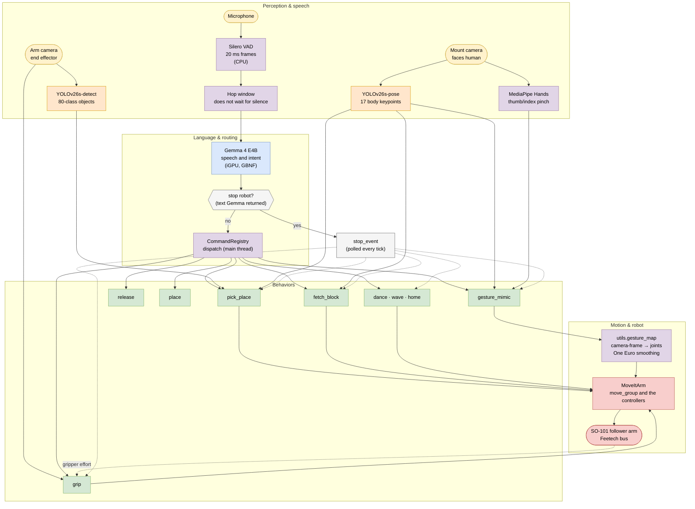
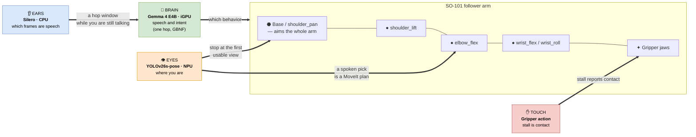
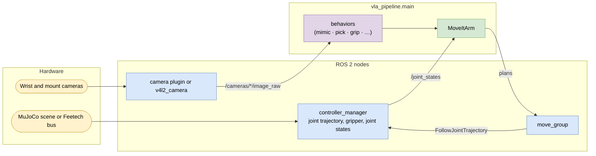

# Strix VVLA Pipeline
Voice-Vision-Language-Action
Gemma4-Yolov26-ROS2

Voice-controlled robot behaviors for the **LeRobot SO-101** arm on an **AMD Ryzen AI APU (Strix Point / Strix Halo, gfx1150 / gfx1151 / gfx1100 for compatibility)** — speech, language, and vision all running locally, split across the NPU, iGPU, and CPU.

The robot has senses: **Gemma 4 is its ears and its brain**, **YOLO is its eyes**, and the **feedback gripper is its sense of touch**. You speak; it hears, understands, looks, and acts.


## Pipeline architecture



Legend — <span title="NPU">🟧 NPU (VitisAI EP)</span> · 🟦 iGPU (ROCm) · 🟪 CPU · 🟩 behavior · 🟥 robot/transport. YOLO-pose and YOLO-detect run on the NPU. Silero runs on the CPU. Gemma 4 E4B runs on the iGPU. See [Compute placement → NPU load order](#npu-load-order-important).

## The robot's senses → an SO-101

Each model maps to a sense, and each sense maps to a part of the arm it informs.



**Ears (Silero) → Brain (Gemma 4):** Silero on the CPU marks 20 ms frames that are speech and louder than −35 dBFS. A hop window of those frames goes to Gemma 4 E4B on the iGPU while the person is still talking. The grammar lets Gemma emit only `{"command", "object", "heard"}`. **Eyes (YOLO-pose) → the arm's aim:** YOLO-pose finds *where you are* and drives `shoulder_pan` for mimicry and handoff. MediaPipe Hands reads the pinch. A spoken "pick up …" is a MoveIt Task Constructor plan. The detector and the reach that place the object stay in the pipeline, because a later VLA finetune is trained on the picks they record. **Touch (gripper) → the jaws:** the parallel gripper action reports a stall when the jaws meet an object, and success when an empty close reaches the goal.

## Voice commands → behaviors

Gemma 4 is constrained by `config/intent.gbnf` so it can only emit `{"command": "<intent>", "object": "<words>", "heard": "<words>"}`. `stop robot` is a keyword on the text Gemma returns and interrupts the running behavior. "stop" alone is not a command.

| Say something like | Intent | What happens |
|---|---|---|
| "mirror my arm", "copy my movements" | `gesture_mimic` | YOLO-pose tracks your wrist; a direct camera-frame mapping drives the arm joints to follow your hand (depth from MediaPipe hand size). MediaPipe tracks your thumb–index pinch → gripper. |
| "pick up the ball", "grab the bottle and give it to me" | `pick_place` | MoveIt Task Constructor plans a pick of the object the command names. The jaws stay closed. |
| "release", "open", "drop it" | `release` | Gemma maps the phrase to `release`. The jaws open where they are and the arm stays put, so the object can be taken or dropped. |
| "place it", "set it down", "set it on the table" | `place` | After a pickup, the arm raises `shoulder_lift` by 0.2 rad, then moves in joint space to the place pose above the current tip and opens the jaw. It says "Done." With nothing it picked up, it says so. If that place does not arrive, it says it cannot set the object down and keeps holding it. |
| "fetch the block", "bring me the cube" | `fetch_block` | Approach the block at its taught pose → grasp → lift → find you (YOLO-pose) → extend → release → home. |
| "hold this", "take this pencil" | `grip` | One goal on the parallel gripper action. A stall locks the grip until "release". An empty close reaches the goal and does not lock. A following `gesture_mimic` hands the gripper to your pinch. |
| "dance", "show me some moves" | `dance` | BPM-paced keyframe choreography. |
| "wave at me", "say hi" | `wave` | Raises the arm and waves `wave.cycles` times. |
| "go home" | `home` | Returns to the rest pose. "home" or "reset" alone is not a command. |
| "stop robot" | `stop` | **Keyword-matched on the text Gemma returns** and interrupts any running behavior immediately. "stop" alone is not a command. |

## Tested environment

| Component | Version |
|---|---|
| Hardware | AMD Ryzen AI MAX (Strix Halo), iGPU `gfx1151`, XDNA 2 NPU |
| OS | Ubuntu 24.04 |
| ROCm | 7.2.4 |
| Ryzen AI SW | 1.7.1 (VitisAI ONNX Runtime EP) |
| ROS 2 | Jazzy (required), with ros2_control and the controllers |
| LeRobot | 0.5.2 (source install, `[feetech]`) |
| PyTorch | 2.11.0+rocm7.13.0 from `repo.amd.com/rocm/whl/<detected gfx>`. The PyPI wheel is not used; it downloads the NVIDIA CUDA stack. |
| Robot | LeRobot SO-101 follower arm |

## Compute placement

The pipeline is powered by AI models that utilize every subsystem of the APU. Each workload runs on the subsystem whose strengths best match its requirements. `./run_pipeline.sh` also pins three programs to one CPU core each. The core numbers are `cores` in `config/pipeline.yaml` (`twin` 2, `control` 3, `perception` 4). The pin is `taskset -c`, which limits that process to the one core. An empty value leaves the program on any core.

<table style="border-collapse: collapse">
<thead>
<tr><th style="background-color: rgba(128, 128, 128, 0.2); border: 1px solid rgba(128, 128, 128, 0.4)">Task</th><th style="border: 1px solid rgba(128, 128, 128, 0.4)">Model or algorithm</th><th style="border: 1px solid rgba(128, 128, 128, 0.4)">What it does</th><th style="border: 1px solid rgba(128, 128, 128, 0.4)">Runs on</th><th style="border: 1px solid rgba(128, 128, 128, 0.4)">Runtime</th></tr>
</thead>
<tbody>
<tr style="background-color: rgba(0, 0, 0, 0)"><td rowspan="2" valign="top" style="background-color: rgba(128, 128, 128, 0.2); vertical-align: top; border: 1px solid rgba(128, 128, 128, 0.4)">Voice control</td><td style="border: 1px solid rgba(128, 128, 128, 0.4)">Silero VAD</td><td style="border: 1px solid rgba(128, 128, 128, 0.4)">marks 20 ms frames that contain speech</td><td style="border: 1px solid rgba(128, 128, 128, 0.4)">CPU (core 4)</td><td style="border: 1px solid rgba(128, 128, 128, 0.4)">ONNX Runtime</td></tr>
<tr style="background-color: rgba(0, 0, 0, 0)"><td style="border: 1px solid rgba(128, 128, 128, 0.4)">Gemma 4 E4B-IT (Q4_0)</td><td style="border: 1px solid rgba(128, 128, 128, 0.4)">a hop of audio → command</td><td style="border: 1px solid rgba(128, 128, 128, 0.4)">iGPU</td><td style="border: 1px solid rgba(128, 128, 128, 0.4)"><code>llama.cpp</code> <code>llama-server</code> (HIP) and the audio projector</td></tr>
<tr style="background-color: rgba(0, 0, 0, 0)"><td rowspan="2" valign="top" style="background-color: rgba(128, 128, 128, 0.2); vertical-align: top; border: 1px solid rgba(128, 128, 128, 0.4)">Gestures</td><td style="border: 1px solid rgba(128, 128, 128, 0.4)">YOLOv26s-pose</td><td style="border: 1px solid rgba(128, 128, 128, 0.4)">finds your body and wrist</td><td style="border: 1px solid rgba(128, 128, 128, 0.4)">NPU</td><td style="border: 1px solid rgba(128, 128, 128, 0.4)">ONNX Runtime, VitisAI EP</td></tr>
<tr style="background-color: rgba(0, 0, 0, 0)"><td style="border: 1px solid rgba(128, 128, 128, 0.4)">MediaPipe Hands</td><td style="border: 1px solid rgba(128, 128, 128, 0.4)">detects the hand gesture (pinch, roll)</td><td style="border: 1px solid rgba(128, 128, 128, 0.4)">CPU (core 4)</td><td style="border: 1px solid rgba(128, 128, 128, 0.4)">MediaPipe Tasks</td></tr>
<tr style="background-color: rgba(0, 0, 0, 0)"><td rowspan="2" valign="top" style="background-color: rgba(128, 128, 128, 0.2); vertical-align: top; border: 1px solid rgba(128, 128, 128, 0.4)">Object localization</td><td style="border: 1px solid rgba(128, 128, 128, 0.4)">YOLOv26s-detect</td><td style="border: 1px solid rgba(128, 128, 128, 0.4)">finds the named object in the arm camera</td><td style="border: 1px solid rgba(128, 128, 128, 0.4)">NPU</td><td style="border: 1px solid rgba(128, 128, 128, 0.4)">ONNX Runtime, VitisAI EP</td></tr>
<tr style="background-color: rgba(0, 0, 0, 0)"><td style="border: 1px solid rgba(128, 128, 128, 0.4)">image_geometry, tf2, MoveIt Task Constructor, pick_ik</td><td style="border: 1px solid rgba(128, 128, 128, 0.4)">places the box-centre ray at the class centre and grasps there</td><td style="border: 1px solid rgba(128, 128, 128, 0.4)">CPU (core 3)</td><td style="border: 1px solid rgba(128, 128, 128, 0.4)">ROS 2, MoveIt 2</td></tr>
<tr style="background-color: rgba(0, 0, 0, 0)"><td valign="top" style="background-color: rgba(128, 128, 128, 0.2); vertical-align: top; border: 1px solid rgba(128, 128, 128, 0.4)">Digital twin</td><td style="border: 1px solid rgba(128, 128, 128, 0.4)">MuJoCo 3D simulation</td><td style="border: 1px solid rgba(128, 128, 128, 0.4)">simulates the arm and the table scene</td><td style="border: 1px solid rgba(128, 128, 128, 0.4)">CPU (core 2), rendering on the iGPU</td><td style="border: 1px solid rgba(128, 128, 128, 0.4)">MuJoCo, EGL</td></tr>
</tbody>
</table>

The same three cores, by program. On the real arm the controller node shares core 3 with `move_group` and MoveIt Servo, and core 2 stays idle.

<table style="border-collapse: collapse">
<thead>
<tr><th style="background-color: rgba(128, 128, 128, 0.2); border: 1px solid rgba(128, 128, 128, 0.4)">CPU core</th><th style="border: 1px solid rgba(128, 128, 128, 0.4)">Config key</th><th style="border: 1px solid rgba(128, 128, 128, 0.4)">What <code>./run_pipeline.sh</code> puts there</th></tr>
</thead>
<tbody>
<tr style="background-color: rgba(0, 0, 0, 0)"><td style="border: 1px solid rgba(128, 128, 128, 0.4)">2</td><td style="border: 1px solid rgba(128, 128, 128, 0.4)"><code>cores.twin</code></td><td style="border: 1px solid rgba(128, 128, 128, 0.4)">MuJoCo, its controllers, the wrist and scene cameras, <code>robot_state_publisher</code>, and the console window</td></tr>
<tr style="background-color: rgba(0, 0, 0, 0)"><td style="border: 1px solid rgba(128, 128, 128, 0.4)">3</td><td style="border: 1px solid rgba(128, 128, 128, 0.4)"><code>cores.control</code></td><td style="border: 1px solid rgba(128, 128, 128, 0.4)">the control process (the arm client and the behaviors), <code>move_group</code>, and MoveIt Servo</td></tr>
<tr style="background-color: rgba(0, 0, 0, 0)"><td style="border: 1px solid rgba(128, 128, 128, 0.4)">4</td><td style="border: 1px solid rgba(128, 128, 128, 0.4)"><code>cores.perception</code></td><td style="border: 1px solid rgba(128, 128, 128, 0.4)">the perception process (YOLOv26s-pose, YOLOv26s-detect, MediaPipe Hands, Silero) and the mount webcam</td></tr>
</tbody>
</table>

The digital-twin notebook starts these same programs and passes no core, so each one may use any core. Its kernel holds the arm client, the behaviors, and the console together. `run_notebooks.sh` starts `llama-server` before the kernel, and that server keeps every core.

A hop window goes to Gemma while the person is still talking. [Voice latency](#voice-latency) is that hop, and the samples in it are not denoised.

Every NPU session is built through one shared factory (`vla_pipeline/utils/npu_session.py`), and each model's `device:` is set in `config/pipeline.yaml`.

### NPU load order (important)

YOLO-pose and YOLO-detect run on the NPU. Voice does not: Silero is on the CPU and Gemma 4 is on the iGPU.

Those two sessions share buffers within a process. The first one sizes them, and they last until the last one closes. Opening YOLO-pose while YOLO-detect is already open fails with `HW context creation unsuccessful / sub buffer size and offset`. `size_npu` opens YOLO-pose first and keeps that session for the life of the process, so the detector can load after it.

A model set to `npu` falls back to CPU, with a warning, if the VitisAI runtime can't give it a session, so the pipeline never crashes over NPU capacity and also runs (slowly) on a plain dev machine. The startup logs say where each model landed.

## ROS 2 nodes & topics

`robot.use_ros2` is the switch that starts the bringup. `launch/so101_control.launch.py` starts the upstream ros2_so_arm controllers, `mujoco_ros2_control` or `feetech_ros2_driver`, and `move_group`. `MoveItArm` plans with MoveItPy and the Task Constructor, drives the gripper action, and streams on `~/joint_trajectory`. The twin's `CameraPlugin` or `v4l2_camera` publishes the images.



### Nodes

| Node | Process / how it starts | Role | Owns |
|---|---|---|---|
| `camera_mount` | `v4l2_camera` from `launch/strix_vla.launch.py` | Publishes the human-facing image on `cameras.mount.topic` | the mount V4L2 device, the real webcam that films the user |
| `camera_arm` | `v4l2_camera`, or the twin's camera plugin | Publishes the wrist image on `cameras.arm.topic` | the arm V4L2 device, or the MuJoCo `wrist_cam` |
| `scene_cam` | the twin's camera plugin | Publishes the overview on `cameras.scene.topic` | the MuJoCo `scene_cam` |
| `controller_manager` | `ros2_control_node` (`launch/so101_control.launch.py`) | Runs `joint_trajectory_controller`, `gripper_controller`, and `joint_state_broadcaster` on `mujoco_ros2_control`, the Feetech driver, or mock hardware | — |
| `robot_state_publisher` | the upstream `so_arm101_description` bringup | Publishes the SO-101 URDF | — |
| `camera_client_mount` | created inside `vla_pipeline.main` (`Ros2Camera`) | Subscribes to the mount image topic, hands the latest frame to behaviors | — |
| `camera_client_arm` | created inside `vla_pipeline.main` (`Ros2Camera`) | Subscribes to the arm image topic for detection / jaw verification | — |
| `so101_arm_client` | created inside `vla_pipeline.main` (`MoveItArm`) | The arm behaviors call. A planned move executes on `joint_trajectory_controller`; the jaws are the gripper action; streamed setpoints go to that controller's `~/joint_trajectory` topic; the state is `/joint_states` | — |

The three client nodes spin on their own background executors inside the single orchestrator process, so from the user's side `python -m vla_pipeline.main` is still one plain program.

`/joint_states` is radians under the URDF names (`shoulder_pan_joint`, …, `gripper_joint`). A pose written in calibrated degrees is converted by `radians_from_calibrated` before the arm is commanded.

### Topics

| Topic | Type | Publisher → Subscriber | Notes |
|---|---|---|---|
| `/cameras/mount/image_raw` | `sensor_msgs/Image` | `v4l2_camera` → `Ros2Camera` | pose / gesture-mimic / person finding. The real webcam that films the user. The topic is `cameras.mount.topic` |
| `/cameras/arm/image_raw` | `sensor_msgs/Image` | `v4l2_camera` or the MuJoCo plugin → `Ros2Camera` | object detection. The topic is `cameras.arm.topic` |
| `/cameras/scene/image_raw` | `sensor_msgs/Image` | the MuJoCo `scene_cam` plugin → the twin console's view | the overview. The topic is `cameras.scene.topic` |
| `/cameras/arm/camera_info` | `sensor_msgs/CameraInfo` | the same publisher → the pickup | intrinsics for the table-plane locate |
| `/joint_states` | `sensor_msgs/JointState` (rad) | `joint_state_broadcaster` → `MoveItArm` and anyone | the arm's state, URDF joint names |
| `/joint_trajectory_controller/follow_joint_trajectory` | `control_msgs/action/FollowJointTrajectory` | `MoveItArm` → the trajectory controller | one goal per planned move or timed keyframe |
| `/gripper_controller/gripper_cmd` | `control_msgs/action/ParallelGripperCommand` | `MoveItArm` → the gripper controller | a close stalls when the jaws meet an object |
| `/free_joint_states` | `mujoco_ros2_control_msgs/FreeJointStateArray` | the MuJoCo prop plugin → behaviors | each prop's pose on the twin |

The camera and hardware topics use best-effort, keep-last depth-1 QoS — the latest frame/state always wins and vision never backs up behind a slow consumer; the controllers' topics and actions use the ROS defaults. Camera frames (0.9 MB each) travel on Fast DDS's `LARGE_DATA` transports: on the default ones, frames were lost for up to 1.7 s at a time while the pipeline ran. `scripts/ryzen_ai_env.sh` sets `FASTDDS_BUILTIN_TRANSPORTS=LARGE_DATA`, so source it (or `activate_venv.sh`) in any shell that watches the camera topics. Device, width, height, and topic come from `cameras:` in `config/pipeline.yaml`. Point `cameras.arm.device` at the wrist camera (a `/dev/v4l/by-id/...` path is more stable than an index). If that topic goes quiet, pick-and-place says the arm camera is offline and does not pick.

Quick inspection:

```bash
ros2 node list                       # controller_manager, move_group, ...
ros2 control list_controllers        # joint_trajectory_controller, gripper_controller, joint_state_broadcaster
ros2 topic hz /cameras/arm/image_raw # the wrist camera
ros2 topic echo /joint_states        # positions in radians, URDF joint names
```

### Digital twin

`--digital-twin` starts `launch/so101_control.launch.py hardware_type:=mujoco`: ros2_so_arm's controllers, MoveIt's `move_group`, and the MuJoCo scene `scene_vvla.xml`. The scene's camera plugins publish the wrist and mount images. The orchestrator drives that bringup with `MoveItArm`. The twin publishes `/clock`. The console's `r` key calls `MoveItArm.reset`, which calls `reset_world` with the `home` keyframe and returns when MoveIt's planning-scene monitor holds a state stamped after that reset.

## Repository layout

```
vvla-pipeline/
├── bootstrap.sh                  # one-shot setup into a uv venv at ./.venv
├── digital_twin_auto_testing.sh # sim tests, then the notebooks; stops at the first failure
├── run_pipeline.sh               # entry point: starts camera + arm nodes, then the orchestrator
├── activate_venv.sh              # source it: ROS 2 + .venv + the NPU runtime environment
├── so101_sim/                    # MuJoCo scene and assets, and the bringup helper (control.py)
├── ros_ws/                       # colcon workspace: ros2_so_arm, moveit_ros_planning, so_arm101_moveit_config
├── patches/                      # patches bootstrap.sh applies to ros2_so_arm and moveit_ros_planning
├── tests/                        # automated tests: the stacks on the twin, the notebooks (see below)
├── workshop/                     # the hands-on workshop: notebooks, the TODO stubs (project/), helpers (common/)
├── config/
│   ├── pipeline.yaml             # all tunables (cameras, gemma4-e4b-it, gesture_mimic, pick_place, grip, …)
│   ├── intent.gbnf               # GBNF grammar: {"command","object","heard"}
│   └── vaiep_config.json         # VitisAI compiler config for YOLO (BF16, VAIML)
├── launch/
│   ├── strix_vla.launch.py       # real-webcam camera nodes, plus so101_control
│   └── so101_control.launch.py   # mujoco, real, or mock hardware, plus move_group
├── scripts/
│   ├── compile_npu_models.{py,sh} # compile the YOLO ONNX for the NPU (SDK venv)
│   ├── ensure_voice.sh           # Gemma 4 GGUF, audio projector, Silero, llama-server check
│   ├── export_yolo26s.py         # YOLOv26s ONNX export: pose (body keypoints) or detect (80 classes)
│   ├── ryzen_ai_env.sh           # LD_LIBRARY_PATH for the VitisAI EP runtime
│   ├── verify_npu_stack.py       # check that the VitisAI EP loads
│   └── validate_setup.sh         # check scripts, SDK, caches and .venv
└── vla_pipeline/
    ├── main.py                   # orchestrator: Gemma listener, handler registry
    ├── user_robot_control.py      # PipelineContext, the behavior registry, stop fast path, dispatch queue
    ├── console.py                # twin console window (--digital-twin)
    ├── audio/
    │   └── gemma_listen.py       # Silero gate and hop windows (no wait for silence)
    ├── llm/
    │   ├── intents.py            # Intent enum, ParsedCommand, CommandRegistry, stop and noise checks, prompt
    │   ├── llama_intent.py       # Gemma 4 on llama-server: text and audio intent
    │   ├── voice.py              # microphone thread; voice_intent is gemma4-e4b-it
    │   └── intent_node.py        # ROS 2 node: transcripts in, intents out
    ├── vision/
    │   ├── camera.py             # CameraClient (direct / ROS 2) per role
    │   ├── yolo_pose_npu.py      # PoseEstimator: letterbox, infer, COCO-17 kpts
    │   ├── yolo_detect_npu.py    # ObjectDetector + spoken-name synonyms
    │   └── mediapipe_hands.py    # HandTracker: normalized thumb–index pinch
    ├── robot/
    │   ├── arm_interface.py      # make_arm, degree tables, JOINT_LIMITS, clamp_joints
    │   ├── ros2_control_arm.py   # Spinner: a private rclpy node for the twin's subscribers
    │   ├── robot_node.py         # MoveIt client round-trip (--client-test)
    │   └── moveit_arm.py         # MoveItArm: plans, timed keyframes, streaming, gripper, reset
    ├── behaviors/
    │   ├── manipulation.py       # grip, release, place, pick and place, fetch, handover
    │   ├── gesture_mimic.py      # camera-frame mapping loop (pinch -> gripper), --calibrate-depth/-grip
    │   ├── dance.py              # keyframe moves, BPM pacing
    │   └── simple.py             # wave, home
    └── utils/
        ├── config.py             # YAML loader, path resolution
        ├── npu_session.py        # shared VitisAI/CPU ONNX session factory
        ├── gesture_map.py        # camera-frame → joint mapping (MimicMapper, One Euro filter)
        ├── resource_monitor.py   # CPU/GPU/NPU power, VRAM, DRAM bandwidth; --hud: the always-on-top window
        └── aie_engines.py        # NPU AI Engines reserved and busy during a test stage
```

The pipeline is the only implementation. The workshop's notebooks and helpers import it, and each workshop TODO stub has the name and parameters of the pipeline function that is its answer key. `tests/sim/test_copies.py` checks those signatures and fails when any definition is written twice or any file is a copy.

## Installation

Ubuntu 24.04, kernel 6.10 or newer, Python 3.12. 64 GB of RAM is recommended. Three stages: the NPU driver, Ryzen AI Software 1.7.1, then this repository. Driver details match the [Ryzen AI 1.7.1 Linux instructions](https://ryzenai.docs.amd.com/en/1.7.1/linux.html).

Download both packages from the Ryzen AI Software downloads page:

- [NPU drivers, `RAI_1.7.1_Linux_NPU_XRT.zip`](https://account.amd.com/en/forms/downloads/xef.html?filename=RAI_1.7.1_Linux_NPU_XRT.zip)
- [Ryzen AI Software, `ryzen_ai-1.7.1.tgz`](https://account.amd.com/en/forms/downloads/xef.html?filename=ryzen_ai-1.7.1.tgz)

### 1. NPU driver

The NPU PCI id is `1022:17f0`. If that search prints nothing, stop. The zip may unpack into a subdirectory, so `find` lands in the directory that holds the `.deb` files. `xrt-smi examine` must list a device (`RyzenAI-npu5`, `NPU Strix`, or `NPU Strix Halo`). If the table is empty, stop.

```bash
sudo apt update
sudo apt install -y python3.12 python3.12-venv libboost-filesystem1.74.0 dkms
lspci -nn | grep 1022:17f0
cd ~/Downloads
unzip -o RAI_1.7.1_Linux_NPU_XRT.zip -d RAI_1.7.1_Linux_NPU_XRT
cd "$(dirname "$(find RAI_1.7.1_Linux_NPU_XRT -name 'xrt_202610.2.21.75_24.04-amd64-base.deb' -print -quit)")"
sudo apt install --fix-broken -y \
  ./xrt_202610.2.21.75_24.04-amd64-base.deb \
  ./xrt_202610.2.21.75_24.04-amd64-base-dev.deb \
  ./xrt_202610.2.21.75_24.04-amd64-npu.deb \
  ./xrt_plugin.2.21.260102.53.release_24.04-amd64-amdxdna.deb
export LD_LIBRARY_PATH="/lib/x86_64-linux-gnu:${LD_LIBRARY_PATH:-}"
source /opt/xilinx/xrt/setup.sh
xrt-smi examine
```

### 2. Ryzen AI Software

This creates `~/ryzen_ai-1.7.1/venv`. Do not unpack the SDK inside this repository. `venv/quicktest/quicktest.py` is the SDK's own NPU check: it compiles a small CNN and prints `Test Finished`, and the provider list includes `VitisAIExecutionProvider`.

```bash
mkdir -p ~/ryzen_ai-1.7.1
cd ~/ryzen_ai-1.7.1
tar -xvzf ~/Downloads/ryzen_ai-1.7.1.tgz
./install_ryzen_ai.sh -a yes -p $PWD/venv
```

### 3. This repository

Clone once. Ultralytics is AGPL-3.0, so `./bootstrap.sh` does not install it or export the YOLO ONNX files. The first bootstrap passes `--skip-compile` because those files do not exist yet. The second one compiles them.

```bash
git clone https://github.com/amd/embedded-x86-ai
cd embedded-x86-ai/workshops/vvla-pipeline
export RYZEN_AI_WHEELS=~/ryzen_ai-1.7.1
./bootstrap.sh --skip-compile
source .venv/bin/activate
pip install 'ultralytics' 'onnxslim>=0.1.82' 'numpy==1.26.4' 'opencv-contrib-python==4.11.0.86'
python scripts/export_yolo26s.py pose
python scripts/export_yolo26s.py detect
./bootstrap.sh --skip-apt --skip-llama --skip-models
```

`./bootstrap.sh` installs the apt packages, ROCm, ROS 2 Jazzy and MoveIt, the `.venv`, the ROCm PyTorch wheels, LeRobot, and llama.cpp with HIP (gfx1100 on Strix). It downloads the Gemma 4 E4B GGUF and its audio projector with `hf download` from `ggml-org/gemma-4-E4B-it-GGUF`, and Silero VAD v6.2.3, through `scripts/ensure_voice.sh`. The second run writes `cache/yolo26s_pose_fp32/` and `cache/yolo26s_detect_fp32/` (about 16 minutes and 3 minutes). `./run_pipeline.sh` sources the venv, ROS 2, and `scripts/ryzen_ai_env.sh`.

`cache/` is not in git and does not copy to another machine: a cache from a different compiler loads and then mis-detects (`recompile model with latest VAIML version`). Delete the two directories above and run the second bootstrap again on this machine. When those `.rai` files were already compiled here, skip the export and the second bootstrap: `./bootstrap.sh --skip-compile` is the whole repository step. Other flags are `--skip-apt`, `--skip-llama`, `--skip-models`, and `--cpu-only`.

### Robot hardware

A real arm needs `motor_port` and `robot_id` in `config/pipeline.yaml`. `lerobot-find-port` prints the Feetech bus, for example `/dev/ttyACM0`; `sudo chmod 666 /dev/ttyACM0` opens it until the next replug. `bootstrap.sh` installs `lerobot-calibrate` for the servos. This repository does not calibrate the camera, and the ROS driver uses the servo EEPROM rather than the LeRobot calibration JSON.

## Running the full pipeline

```bash
./run_pipeline.sh                     # voice control, full hardware
./run_pipeline.sh --text-commands     # type commands instead of speaking
./run_pipeline.sh --dry-run           # no robot hardware (prints joint targets)
./run_pipeline.sh --digital-twin      # no robot hardware: the MuJoCo twin, shown in the twin console window
./run_pipeline.sh --headless          # no OpenCV preview windows
```

The script sources ROS 2 Jazzy, the `ros_ws` overlay, the venv and the Ryzen AI NPU environment (`scripts/ryzen_ai_env.sh`), runs first-time calibration if needed (foreground, real arm only), and starts `launch/strix_vla.launch.py`. That launch is `hardware_type:=real` (the Feetech driver), `mock_components` with `--dry-run`, or `mujoco` with `--digital-twin`. Device camera nodes start only for the real arm. The orchestrator always drives that bringup with MoveIt, and Ctrl-C tears the launch down. Equivalent ROS launch:

```bash
ros2 launch launch/strix_vla.launch.py                 # Feetech bus, move_group, device cameras
ros2 launch launch/strix_vla.launch.py dry_run:=true   # mock hardware
ros2 launch launch/strix_vla.launch.py digital_twin:=true
source scripts/ryzen_ai_env.sh                    # orchestrator terminal: NPU runtime for YOLO
python -m vla_pipeline.main                       # orchestrator (own terminal)
```

A resource-usage CSV (CPU %, RAPL package power, iGPU busy %/VRAM via `rocm-smi`, DRAM bandwidth via AMD perf events) is written to `logs/` on every run. [Compute placement](#compute-placement) lists which model runs on which device.

## Gesture mimicry: direct camera-frame mapping

Mimicry maps the camera image straight onto SO-101 joints (`MimicMapper` in `vla_pipeline/utils/gesture_map.py`): the image is treated as a control surface, and four normalized axes in `[-1, 1]` drive per-joint offsets from a neutral "ready" pose, every command clamped to the joint limits (no analytic IK, no arm-geometry solve). All gains live under `behaviors.gesture_mimic` in `config/pipeline.yaml`.

1. **Left/right (x)** from the YOLO-pose wrist keypoint's horizontal position → `shoulder_pan`.
2. **Up/down (y)** from the wrist keypoint's vertical position → `elbow_flex` at full authority, `shoulder_lift` at its lower ~50%, and `wrist_flex` as a level-keeping fine-tune. The YOLO wrist is also the fallback controller: when MediaPipe loses the hand the arm keeps following it for x/y.
3. **Depth from hand size**: MediaPipe hand span in pixels ∝ 1/distance → forward/back, extending `shoulder_lift` through its upper half with `elbow_flex` going negative. The neutral size auto-calibrates from the first frames (or set `hand_size_neutral`).
4. **Wrist roll** from the MediaPipe directed thumb→index vector (knuckle-line, then wrist→knuckle, as reliability-weighted fallbacks; all unwrapped so roll only moves on a real rotation).
5. **One Euro filter** on the four control axes (smooth at rest, low lag in motion; tune `mimic.smoothing.min_cutoff` for rest jitter, `beta` for lag).

The gripper follows the MediaPipe thumb↔index distance as a continuous ramp: held closed within the first `grip_close_frac` of the calibrated `grip_min`..`grip_max` range, then opening linearly to `grip_open_pos` (~90%). It holds its last position whenever the hand is unseen. Until the first thumb↔index distance is measured the gripper is not commanded, so a held object stays held.

### Depth and grip calibration (one-time)

```bash
python -m vla_pipeline.behaviors.gesture_mimic --calibrate-depth   # neutral hand size (depth)
python -m vla_pipeline.behaviors.gesture_mimic --calibrate-grip    # thumb↔index min/max (gripper)
```

Hold your hand at a comfortable mid-distance, then paste the printed `hand_size_neutral` into `behaviors.gesture_mimic` in `config/pipeline.yaml`; with `hand_size_neutral: 0` the neutral auto-calibrates from the first few frames instead. `--calibrate-grip` has you pinch and then spread your fingers to measure `grip_min`/`grip_max` for the gripper ramp.

### Pose backend choice

Kept: **YOLOv26s-pose on the NPU for the body + MediaPipe Hands on CPU for the pinch.** Rationale: the NPU session is already compiled/cached, runs at camera rate without touching CPU/iGPU budgets needed by Gemma and MediaPipe, and COCO-17 keypoints are exactly what the mapper needs; MediaPipe Hands remains the best cheap pinch detector. The often-suggested alternative — MediaPipe Pose with world landmarks (metric 3-D, CPU) — would give Z without calibration, but costs CPU it would share with MediaPipe Hands, adds a second pose stack to fuse, and its world-landmark Z is noisy enough at 2-3 m that it needs the same One Euro treatment anyway. The mapper is backend-agnostic (consumes COCO-17 arrays), so swapping the estimator later is a one-file change.

## Gripper: closing on contact

`grip` on `MoveItArm` sends one goal on the parallel gripper action. The controller reports success when the jaws reach the goal, or when they stall (`allow_stalling: true`). Grip, fetch, and the Task Constructor close all use that action.

- A stall is contact. `run_grip` locks the grip only when the close stalls. An empty close reaches the SRDF `close` pose and does not lock.
- The action's own stall check is the result. The client waits for that result. It does not sample current or watch the camera.

## Voice latency

Gemma does not wait for the end of speech. Silero and a −35 dBFS check mark each 20 ms frame. A window of `window_s` (6 s) is sent every `hop_s` (2 s) once that hop holds at least `min_voice_ms` (100 ms) of speech, so the first clip waits 2 s and a short command fits inside it. At the tradeshow the arm moved about a second after the person stopped. `stop robot` is a keyword on the text Gemma returns, so the stop does not wait for another hop to be classified as a new command. "stop" alone does nothing.

### No denoiser

Frames that pass Silero and the −35 dBFS check are sent as recorded. There is no noise-suppression stage. `vla_pipeline/llm/voice.py` already does that. Google's audio guide for Gemma 4 specifies one channel, 16 kHz, float samples from −1 to 1, and a Fourier resample. It does not specify a denoiser ([Audio understanding](https://ai.google.dev/gemma/docs/capabilities/audio)).

A cleaner in front of this model is a poor trade. Gemma 4 E4B is weaker on noisy spontaneous speech than on clean read speech, and it inserts words when the audio is hard ([Open ASR write-up](https://twango.dev/writing/gemma4-asr-benchmark)). A 20-clip noisy-English set measured 7.6% word error ([TypeWhisper](https://typewhisper.github.io/typewhisper-benchmark/?model=crispasr%3Agemma4-e4b-it-q8_0&view=model)). MetricGAN raised the error for Whisper, Parakeet, and Gemini on every noise condition tried, including clips that were already clean ([When De-noising Hurts](https://arxiv.org/html/2512.17562)). SAM-Audio separation raised the signal-to-noise ratio and still raised Whisper's word error ([When Audio Separation Hurts](https://arxiv.org/html/2603.04710v2)). On large audio-language models, ordinary denoisers sometimes made the internal noise measure worse ([SEE](https://arxiv.org/html/2601.07331)). The enhancer invents a spectrum the encoder was not trained on, and the language model then guesses the missing words.

A tradeshow floor is another person talking. Silero treats that as speech and passes it. Separating one voice out of a crowd is the approach those measurements found raised error. A mild steady-noise suppressor (RNNoise or DeepFilterNet, gain only where speech is absent) is a later experiment for a fan louder than the visitors, scored by whether the command intent still matches. It is not this path. The NPU overlay is unrelated: Gemma's audio encoder runs on the iGPU through `llama-server`.

## Voice pick-and-place

"Pick up the ball" → `{"command": "pick_place", "object": "ball"}` → `run_pick_place` in `vla_pipeline/behaviors/manipulation.py`: the arm walks the SRDF scan states, and at each one YOLOv26s-detect on the wrist image grounds the name (synonym table: ball→sports ball, mug→cup, …). The first box that locates and whose Task Constructor pick arrives is the grasp. The jaws stay closed.

**Locate:** objects rest on the table, so one camera is enough. The wrist optical frame comes from tf2. `image_geometry` casts a ray through the YOLO box centre, and the class size puts that centre half a height above the table. The ray meets that plane. A sphere has to land within 10 mm, a bottle within 5 mm, and a flat object within 25 mm. **Reach:** a MoveIt Task Constructor pick. `GenerateGraspPose` spins the jaw-down grasp about vertical, and `ComputeIK` solves it with pick_ik. The jaw pad is `gripper_frame_link`. The grasp frame is the object's centre in that link. Only the arm camera can locate an object, so with it offline the arm says so and does not pick.

**Real arm calibration.** A real arm (`robot.backend: real`) does not pick until its camera is calibrated: with `cameras.arm.intrinsics` or `cameras.arm.extrinsics` unset, the behavior ends as failed before the arm moves. Servo calibration is `lerobot-calibrate`, which `bootstrap.sh` installs. `camera_calibration` and `easy_handeye2` are not installed. The twin's `wrist_cam` model is the camera the digital twin uses.

Failure handling speaks, and a behavior that gives up ends as failed (not "done"): unknown word ("I don't know what that looks like"), nothing found, a pick that does not arrive, the arm camera offline, a real arm whose camera is not calibrated. The scan walks the SRDF states `scan_1` through `scan_8`, then `scan_near_1` through `scan_near_5`, and stops at the first detection whose pick arrives. The twin scene uses four textured props that are actual COCO-80 classes: sports ball, book, bottle, and toothbrush. COCO still has no `cube` or `pen` class; those names fail safely unless YOLO is fine-tuned and `SYNONYMS` is extended. One-time setup: `python scripts/export_yolo26s.py detect`.

**Known misses.** The ball, the bottle, and the toothbrush are picked and set back down on the default scene. The toothbrush fingers were 10.8° off the brush; the check is 10° and stays 10°. The book is a known miss: the fingers cannot clear the table and still meet a book 12 mm thick. The ball at (0.32, 0) has no inverse kinematics, and that spot is not forced. A bottle on its side is a detection miss: the same YOLO scores the upright bottle as bottle and the bottle on its side as banana.

## Adding a voice command

1. Add the member to `Intent` and one line to `INTENT_SYSTEM_PROMPT` (`vla_pipeline/llm/intents.py`).
2. Add the name to the `cmd` rule in `config/intent.gbnf`.
3. Register a handler in `vla_pipeline/main.py`: `@registry.register(Intent.MY_COMMAND)` — it receives `(ctx, cmd)` with the arm, cameras, models, `cmd.params`, and `ctx.stop_check`.

`wave` and `home` (`vla_pipeline/behaviors/simple.py`) are the template. `stop robot` is keyword-matched on the text Gemma returns and interrupts any running behavior — including mid-move (every move's wait checks `stop_check`). "stop" alone is not a command.

## Testing each component independently

Most components are standalone modules with their own `__main__` self-test. Pick and place, fetch, grip and the camera-to-joint mapping are tested on the digital twin.

| Component | Needs hardware? | Command |
|---|---|---|
| Camera→joint mapping (One Euro/depth) | no (twin) | `./run_sim_tests.sh -k mimic` |
| Intent grammar + parser | Gemma server running | `python -m vla_pipeline.llm.llama_intent --selftest` |
| YOLO pose | webcam | `python -m vla_pipeline.vision.yolo_pose_npu --device npu` |
| YOLO detect | webcam | `python -m vla_pipeline.vision.yolo_detect_npu --find ball --role arm` |
| MediaPipe hands | webcam | `python -m vla_pipeline.vision.mediapipe_hands` |
| Camera client | webcam | `python -m vla_pipeline.vision.camera --role mount` |
| Wrist camera | ROS 2 | `ros2 launch launch/strix_vla.launch.py` starts `v4l2_camera` |
| ROS 2 server node + controllers | ROS 2 (arm optional) | `ros2 launch launch/strix_vla.launch.py cameras:=false dry_run:=true` |
| ROS 2 client round-trip | ROS 2, the line above running | `python -m vla_pipeline.robot.robot_node --client-test` |
| Gesture mimic | webcam | `python -m vla_pipeline.behaviors.gesture_mimic --dry-run` |
| Pick and place | no (twin) | `./run_sim_tests.sh -k pick` |
| Fetch block | no (twin) | `./run_sim_tests.sh -k fetch_block` |
| Dance | no | `python -m vla_pipeline.behaviors.dance --dry-run` |
| Grip | no (twin) | `./run_sim_tests.sh -k grip` |
| Wave / home | no | `python -m vla_pipeline.behaviors.simple --behavior wave --dry-run` |

A lightweight **always-on-top resource HUD** for live demos ships with the
workshop: `workshop/launch_monitor.sh` (or `from vvla_workshop.monitor import
open_monitor` inside a notebook) floats **CPU %**, **GPU %**, and **NPU
inferences/sec** (or Idle) over every window: `python -m
vla_pipeline.utils.resource_monitor --hud`.

## Automated tests

Two commands. A CI runner on a Ryzen AI machine runs both. On a Strix Halo the pair takes about 20 minutes.

```bash
./digital_twin_auto_testing.sh              # sim, then notebooks; stops at the first failure
cd workshop && ./run_notebooks.sh --test    # notebooks and the Instructor's corner
./run_sim_tests.sh                          # NPU load order and the twin scenarios
```

`./digital_twin_auto_testing.sh` is the one entry point. It runs the sim stage and then the notebooks, and it exits with the first failing stage's status without starting the stages after it. Each run writes `logs/twin-tests/<run id>/`.

`./run_notebooks.sh --test` does the setup [workshop/README.md](workshop/README.md) describes: the `.venv`, the Ryzen AI runtime, ROS 2, and llama-server on the iGPU, started through `python -m vla_pipeline.llm.llama_intent --serve`. It checks that `bootstrap.sh` registered the `vvla-workshop` kernel with ROS 2 and the NPU runtime in its `kernel.json`, and the notebook kernels get them from there alone, as VS Code starts them. Then it runs the notebooks in `workshop/notebooks/`, in the README's order, and the README's Instructor's corner commands.

`./run_sim_tests.sh` uses the same `.venv`, Ryzen AI runtime, and ROS 2. It runs `pytest tests/npu`, then `pytest tests/sim -m "sim and not docs"`, then `pytest tests/moveit`. Arguments after the command go to the twin tests only. `tests/moveit` is `test_arm`, `test_behaviors`, `test_bringup`, `test_detect`, `test_scene`. `tests/sim` is `test_arm_interface`, `test_copies`, `test_description`, `test_dispatch`, `test_ensure_voice`, `test_entry_points`, `test_jaw_geometry`, `test_launch_split`, `test_notebook_cell_errors`, `test_pick_scan`, `test_reset_paths`, `test_run_pipeline_args`, `test_scripted_pose`, `test_spin`, `test_twin_infra`, `test_twin_ros`, `test_ui_poll`, `test_voice_phrases`, `test_workshop_docs`, `test_workshop_notebooks`. It does not start llama-server or Jupyter, and it does not run the tests marked `docs` (the notebooks, the Instructor's corner, and the notebook console). Those belong to `./run_notebooks.sh --test`. Each notebook runs as stored. A live cell is left by the button that notebook draws.

Spoken commands are injected as text. The operator's pose and hands are scripted. The arm camera is read by YOLO on the NPU (`--sim-eyes seg` substitutes the twin's segmentation boxes). The twin stands in for the arm and its camera, and its rendering runs on the iGPU. No arm, camera, or microphone has to be attached. The ROS cases run headless on a private ROS domain, and the exit code is the result.

Spoken commands, and how each one is checked: in process (the real `UserRobotControl` and the mock LLM on the twin), and over ROS 2 (the notebook console's context on the notebook twin, through `handle_transcript` and the keyword parser). A cell is blank when that path does not run the case. "Parks at rest" means the body joints finish within 4° of the rest pose.

| Use case | Command | In process | Over ROS 2 |
|---|---|---|---|
| Wave | `wave at me` | `wave` starts and ends ok. The LLM request carries a grammar and temperature 0. The elbow goes below −35° and the pan passes +20° and −20°. Parks at rest. | Pan span is greater than 40°. |
| Stop a wave | `wave`, then `stop robot` | `stop` is the keyword path: one transcript is parsed, and it is not `stop`. The elbow goal moves within 150 ms, and the pan goal does not return to ±25° after that. The wave ends stopped. Parks at rest. |  |
| Startup noise | `wave`, `thank you.`, `you`, `...` inside a 1 s grace window | Dropped as grace, then three noises. The mock LLM receives nothing. The joints stay put. |  |
| Release | `drop it`, then `open`, then `release` | Three `release` behaviors end ok. The arm says "Released", the gripper passes 80°, and the grip lock is cleared. Parks at rest. | After `pick up the ball`: says "Released", gripper past 80°, and the twin's props (TF frames and `/diagnostics`) show the ball released. Joints come from `/so101/hardware/joint_states`. |
| Go home | `go home` | From a displaced pose, `home` ends ok. Parks at rest. | From a displaced pose, the body joints finish within 4° of rest. |
| Dance | `let's dance` / `dance` | `let's dance`: `dance` ends ok, at least two body joints span more than 20°, and every sample stays inside the joint limits. Parks at rest. | `dance`: the body joints finish within 4° of rest. |
| Hold an object | `hold this for me` | The toothbrush is placed in the jaws once the arm presents. The grip lock is set, the brush stays grasped for at least 1 s, the current held for 0.3 s is above 80 counts, and the arm says "Object gripped". |  |
| Hold nothing | `hold this` | The current held for 0.3 s is under 80 counts. No grip lock is set. |  |
| Pick up the ball | `pick up the ball` | Default scene, and at (0.22, −0.04) and (0.25, −0.10). The arm says "Got the sports ball". The ball rises more than 30 mm. At (0.25, −0.10) every other prop moves less than 1 cm. The far spot (0.32, 0) has no inverse kinematics and is not a pass. | Default scene. Says "Got the sports ball". The ball rises more than 30 mm. Every other prop moves less than 2 cm. |
| Pick up the toothbrush | `pick up the toothbrush` | Default scene. The arm says "Got the toothbrush". The brush rises more than 30 mm and, after place, is back within 15 mm in z. | The same rise check as the ball, for the toothbrush. |
| Pick up the bottle | `pick up the bottle` | Default scene. The arm says "Got the bottle". The bottle rises more than 30 mm and, after place, is back within 15 mm in z. | The same rise check as the ball, for the bottle. |
| Pick with the arm camera offline | `pick up the ball`, with no arm camera | The arm says "The arm camera is offline" and the pick returns before it looks. |  |
| Pick on a real arm without a camera calibration | `pick up the ball`, with `robot.backend: real` and no `cameras.arm` intrinsics or extrinsics | The arm says the camera is not calibrated and the pick ends before the detector runs. |  |
| Unknown object | `pick up the pen` | The arm says "don't know what a pen looks like". A staged toothbrush is never grasped, and no prop is moved. Parks at rest. |  |
| Bring the block | `bring me the block` | Ball staged at `block_pose`: `fetch_block` ends ok, the ball rises more than 3 cm and stays held until the gripper goal passes 90°, then it is released. Parks at rest. Ball left on the table: the arm says "couldn't get a grip", the ball is never grasped, and the arm parks. |  |
| Copy a sweep, a pinch, and a roll | `copy my movements`, then `stop robot` | The pan follows the wrist across the frame: the two ends are more than 25° apart, and the goal tracks the sweep with an absolute correlation above 0.9. A pinch closes the gripper to the closed floor. Wrist roll goes both ways by more than 15°. Joints stay inside the mimic limits. Parks at rest. | A scripted person and pinch: some body joint moves more than 2°, the grip lock is cleared, and the gripper moves more than 5°. `stop` from another thread ends the behavior, and the joints then drift less than 1°. |
| Hand a locked grip to the pinch | `copy my movements`, then `stop robot` | `copy my movements`. The arm says "Your pinch drives the gripper" and clears the grip lock. Open fingers open the gripper; a pinch closes it to the floor. |  |
| Keep a held ball until a pinch is seen | `pick up the ball`, then `copy my movements` | The pickup grasps the ball. During mimic the gripper goal does not open before a pinch is reported, and the ball stays grasped. |  |
| Hand leaves, then the person leaves | `mirror my arm`, then `stop robot` | With no hand, the wrist still moves the pan by more than 20°. After the person leaves, the pan goal's peak-to-peak is under 1.5°. |  |
| Follow the nearer person | `follow me`, then `stop robot` | Two people are in frame. The pan goal settles above +20°, toward the nearer wrist on the left. |  |
| Pick the toothbrush, drop it, reset, and pick it again | `pick up the toothbrush`, `drop it`, reset, repeated three times | Each pickup says "Got the toothbrush" and the brush is grasped. Each drop says "Released". Reset is `MoveItArm.reset`. |  |

The same command also runs these checks. None of them speak a command.

| Check | How it is checked |
|---|---|
| NPU load order | In a fresh process, the pipeline builds YOLO-detect and then YOLO-pose. Both sessions report `VitisAIExecutionProvider`. Without the YOLO caches, `VVLA_TEST_STRICT=1` fails the YOLO cases. |
| NPU sizer | `sizer_onnx` returns the YOLO-pose file when both YOLO models are on the NPU, and the YOLO-detect file when pose is on the CPU. |
| pick_ik solve rate | From the home pose, pick_ik solves the jaw-down grasp on each prop in `scene_vvla.xml`, and that grasp turned about vertical in 30° steps. Yaw 0 solves for the ball, the bottle, the toothbrush, and the book. The rates are written to `_artifacts/moveit/pick_ik_solve_rate.json`. |
| Locate | A wrist-camera box at a scan pose is the box centre's ray at the class centre height, compared with the prop on ``/free_joint_states``. A sphere lands within 10 mm, a bottle within 5 mm, and a flat object within 25 mm. |
| One implementation | Each workshop TODO stub has the parameters of the pipeline function it mirrors. No top-level function, class or constant is defined twice (same name, at least 75 % alike once docstrings are set aside), and no file is a byte-for-byte copy. The twin's default rest pose and jaw closed point are the pipeline's. `make_arm` builds a MoveIt arm. |
| Motion | An untimed move's cruise, the median of the samples within 10% of it, equals that joint's `max_velocity` in `joint_limits.yaml`. A timed keyframe takes its `duration_s` on the arm's clock. A stop cancels the goal and the arm holds. The jaws open and close on the gripper action. |
| Handover | The pan aims at the person with one joint-interpolation move. A held ball stays held through a mimic tick that has not seen a pinch. |
| Stop during the parse | Through `UserRobotControl` and through `handle_transcript`, a "stop robot" said while the LLM parses a command cancels that command; a "stop robot" said before it does not. |
| Robot description | The bringup is upstream `so_arm101_description`, not the topic bridge. Every joint turns about the twin's axis, and the controllers drive those joints. |
| Pipeline over ros2_control | MoveIt on the MuJoCo bringup plans to named states and plays timed keyframes. A pickup leaves a stopped ball, bottle, or toothbrush more than 30 mm up, and place puts it back within 15 mm in z. |
| Entry points | `run_pipeline.sh --digital-twin` (with the docs tests: it needs llama-server) starts the MuJoCo MoveIt bringup and runs typed commands through pick, release, wave, an empty grip, home, and a dance stopped after a keyframe. `launch/strix_vla.launch.py dry_run:=true` is mock hardware, and `robot_node --client-test` plans to `ready` and `home`. |
| Reset | `MoveItArm.reset` calls `reset_world` with the `home` keyframe. The arm parks on the SRDF home pose and every prop returns to its pose in `scene_vvla.xml`. |
| Twin building blocks | A rendered frame carries the time its scene was captured. A scene snapshot round-trips. The console's camera fan-out judges a stamped frame by its capture time, and an unstamped frame by its arrival time. |
| ROS twin plumbing | The MuJoCo bringup publishes the wrist camera, the scene camera, and prop poses on `/free_joint_states`. A publisher on another ROS domain is invisible, and a second twin on the test domain is refused. Killing the notebook kernel reaps the bringup. Reset puts every prop back on its scene-file pose and parks the arm. |
| Notebook UI polling | In a real `python3` kernel, a cell queued behind a `ui_events` loop runs after the loop ends. Jupyter's stop button cancels a queued cell and interrupts the running one. Running the loop cell again ends the loop. |

Arguments after `./run_sim_tests.sh` select twin tests, for example `./run_sim_tests.sh -k toothbrush`. `--sim-yolo-device cpu` runs YOLO on the CPU on a machine without an NPU. `--sim-video failed` keeps the recordings of failed tests only (by default every test is recorded to `_artifacts/sim_tests/`).

## Configuration

All tunables live in `config/pipeline.yaml`:

- **gemma4-e4b-it** — GGUF, audio projector, Silero path, `window_s` (6), `hop_s` (2), `min_dbfs` (−35), `llama-server` port 8082, GPU layers, ctx size, GBNF path, `hsa_override_gfx_version`
- **audio** — sample rate (16 kHz) and which microphone
- **yolo_pose / yolo_detect / mediapipe** — confidence thresholds, cache keys, hand-roll cue threshold
- **cameras** — per-role (`mount` / `arm`) device, resolution, fps, rotation, `use_ros2`, topic
- **robot** — `use_ros2`, `motor_port`, `robot_id`, topics, control FPS
- **mimic / fetch_block / pick_place / dance / wave** — the behaviors: mimic's camera-to-joint gains, mirror, depth and grip calibration and One Euro smoothing; fetch keyframes; table height, set-down clearance and the wrist-align elongation; dance BPM; wave cycles
- **intent_node** — the transcript and intent topics of `vla_pipeline.llm.intent_node`
- **resource_monitor** — sample rate, CSV output

## Architecture notes

- **One arm.** `launch/so101_control.launch.py` starts the ros2_control bringup (`mujoco`, the Feetech bus, or mock hardware) and `move_group`. Behaviors talk to `MoveItArm`: MoveItPy for a planned joint goal, a timed keyframe on the joint trajectory controller, and a MoveIt Task Constructor pick and place. A move ends when that controller reports the goal. Mimic streams setpoints on the controller's `~/joint_trajectory` topic.
- **Grammar-constrained intent.** llama.cpp's GBNF support means the LLM physically cannot emit anything but one of the command JSONs (`gesture_mimic`, `fetch_block`, `pick_place`, `dance`, `grip`, `release`, `place`, `wave`, `home`, `stop`, `unknown`) with an `object` slot.
- **Registry dispatch.** The orchestrator never hardcodes behaviors; `user_robot_control.build_registry` registers the handlers on a `CommandRegistry`, so adding a command never touches the dispatch loop.
- **Grip-lock.** `grip` and `pick_place` record the held position in shared state, so a second "hold this" is refused while the arm holds something. `release` ("release", "open", "drop it") clears the lock and opens the jaws where they are. `place` ("place it", "set it down") clears it once a picked object rests on its place spot. `gesture_mimic` clears it too and hands the gripper to your pinch, so a later "place it" refuses.
- **Safety.** `clamp_joints` and `JOINT_LIMITS` are the workshop desk margin: the mechanical range pulled in so mimic stops short of the desk. The URDF limits are wider. `enforce_command_limits` is left at its Jazzy default of false. Degree poses still pass through `clamp_joints` before `radians_from_calibrated`. The trajectory controller's speed is `joint_limits.yaml`. `stop robot` is a keyword on the text Gemma returns and sets a shared stop event every move checks (a trajectory goal is cancelled, and the arm holds where it is). "stop" alone is not a command. `q` in any preview window and Ctrl-C are equivalent. A behavior that finishes calls `go_to_rest`, the SRDF `home` pose with the jaws closed. Shutdown closes the arm.

## Troubleshooting

- **"VitisAI EP not available — falling back to CPU"** — the NPU driver is missing or `xrt-smi examine` does not list an NPU. Install the four driver packages in [Installation](#installation), then set `RYZEN_AI_WHEELS` and rerun `./bootstrap.sh`. `ls /dev/accel/` must show the XDNA device.
- **`recompile model with latest VAIML version`** — `cache/` was built with a different compiler than this driver. Delete `cache/yolo26s_pose_fp32` and `cache/yolo26s_detect_fp32` and compile again on this machine. Do not copy `cache/` from another computer.
- **torch sees no GPU** — add yourself to `render`/`video` groups (`sudo usermod -a -G render,video $USER`) and reboot.
- **`HW context creation unsuccessful` / `sub buffer size and offset` when loading a model on the NPU** — YOLO-pose was opened while YOLO-detect was already open in the same process. Open YOLO-pose first and keep that session (`size_npu`). See **Compute placement → NPU load order**.
- **NPU model falls back to CPU unexpectedly** — check the startup logs; a model set to `npu` that can't get a session logs a warning and runs on CPU rather than crashing.
- **Camera preview shows "no frames — camera offline"** — with `use_ros2: true` the preview subscribes to a topic, so `v4l2_camera` or the twin's camera plugin has to be publishing. Start the bringup (`./run_pipeline.sh`), or test the raw device directly by setting that role's `use_ros2: false`. Confirm the device captures at all with `v4l2-ctl -d <by-id path> --list-formats-ext`.
- **Two identical USB cameras swap on reboot** — use the stable `/dev/v4l/by-id/...-video-index0` symlink (the `-index0` node is the capture node) for `cameras.*.device` instead of a numeric index.
- **llama-server fails to start** — check `third_party/llama.cpp/build/bin/llama-server` exists; rebuild with `./bootstrap.sh --skip-apt --skip-models`. On failure the last 20 lines of `logs/llama-server.log` are printed.
- **llama-server segfaults with `cudaMalloc failed: out of memory`** — the KV cache overflowed the iGPU VRAM carve-out. Keep `gemma4-e4b-it.ctx_size` capped (2048) and `gemma4-e4b-it.parallel: 1`; never run the server with an uncapped context on Strix Halo. If still tight, lower `n_gpu_layers`, or raise the UMA/VRAM split in BIOS.
- **llama-server segfaults during "warming up the model"** — a gfx1151 ROCm kernel-dispatch issue. The pipeline sets `HSA_OVERRIDE_GFX_VERSION` automatically; if it persists, set `gemma4-e4b-it.no_warmup: true`.
- **Arm doesn't move** — verify `motor_port` permissions and that your calibration JSON matches `robot_id`.
- **The bringup does not come up** — `ros2 control list_controllers` should show `joint_trajectory_controller`, `gripper_controller`, and `joint_state_broadcaster` active. `./scripts/validate_setup.sh` checks ROS 2 and ros2_control.
- **Gripper trips `Overload error` on shutdown** — usually a side effect of an abnormal exit while the arm was parking; once the run exits cleanly it goes away. If it recurs, power-cycle the servo bus to clear the overload latch before the next run.
- **The first words of a command win, or the arm feels late** — `gemma4-e4b-it.hop_s` is 2 so a short command fits in the first clip. Raising it waits longer before the first window. The samples are not denoised; a second person talking is speech and is sent with the command.
- **Arm camera image is sideways** — set `cameras.arm.rotate` (0/90/180/270) to match the end-effector mounting.
